<p align="right"><b>English</b> · <a href="README_ko-KR.md">한국어</a></p>

<p align="center">
  <a href="docs/assets/cover/cover-dark.mp4">
    <picture>
      <source media="(prefers-reduced-motion: reduce) and (prefers-color-scheme: dark)" srcset="docs/assets/cover/poster-dark.webp">
      <source media="(prefers-reduced-motion: reduce)" srcset="docs/assets/cover/poster-light.webp">
      <source media="(prefers-color-scheme: dark)" srcset="docs/assets/cover/cover-dark.webp">
      <source media="(prefers-color-scheme: light)" srcset="docs/assets/cover/cover-light.webp">
      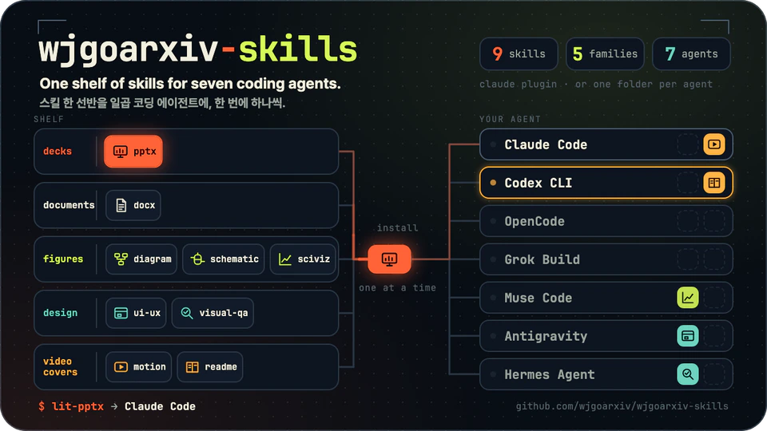
    </picture>
  </a>
</p>

<p align="center">
  <b>LitFamily extensions for seven coding agents.</b><br>
  Decks, documents, figures, interfaces, films and READMEs, installed one family or one folder at a time.<br>
  <sub>Silent cover film: <a href="docs/assets/cover/cover-dark.mp4">dark MP4</a> · <a href="docs/assets/cover/cover-light.mp4">light MP4</a></sub>
</p>

# wjgoarxiv-skills

Nine content skills for LitFamily, my set of add-ons that brings one way of working (plans, loops, goals, reviews) to
seven coding agents. They make decks, documents, figures, interfaces, films and READMEs, and you install only the ones
you need. Each one also works without any LitFamily product.

> [!TIP]
> On Claude Code, the lines in [Quick start](#quick-start) install one family; then ask your agent for a deck. Every
> other harness clones this repository once and copies one folder.

## Pick your path

| I want to… | Do this | Go to |
| --- | --- | --- |
| See what each skill makes | Read the skill table and family pictures | [What you can make](#what-you-can-make) |
| Install on Claude Code | Add the marketplace, install one family | [Quick start](#quick-start) |
| Install on another harness | Clone once, copy one folder | [Pick one skill for one harness](#pick-one-skill-for-one-harness) |
| Update or remove a copy | Rerun the lines, or move the copy aside | [Update and remove](#update-and-remove) |
| Know where the editions came from | Read the source commits and changes | [How it works](#how-it-works) |
| Maintain this repository | Layout, edited files, rules, checks | [Reference](#reference) |

## Quick start

Claude Code installs a family straight from GitHub, which makes it the shortest path. Any other harness follows its own
lines under [Per-harness notes](#per-harness-notes).

1. Find your skill and its family in the [pick-one table](#pick-one-skill-for-one-harness).
2. Run the check lines. Line 1 lists a same-name skill of your own; lines 2 and 3 move a personal or project copy aside.
3. Run the install lines, keeping the line for your family.
4. Ask for what the skill makes: a deck, a document, a figure, an interface, a film or a README.

Run from your project folder before installing:

```bash
ls -d ~/.claude/skills/lit-pptx .claude/skills/lit-pptx 2>/dev/null
d="$HOME/.claude/extension-backups/$(date +%Y%m%d-%H%M%S)"; mkdir -p "$d" && mv ~/.claude/skills/lit-pptx "$d"/
d=".claude/extension-backups/$(date +%Y%m%d-%H%M%S)"; mkdir -p "$d" && mv .claude/skills/lit-pptx "$d"/
```

Then run from any folder, keeping only the families you want:

```bash
claude plugin marketplace add wjgoarxiv/wjgoarxiv-skills
claude plugin install decks@wjgoarxiv-skills
claude plugin install documents@wjgoarxiv-skills
claude plugin install figures@wjgoarxiv-skills
claude plugin install design@wjgoarxiv-skills
claude plugin install video-covers@wjgoarxiv-skills
```

You are set when the skill answers as `decks:lit-pptx` (or `<family>:<id>` for yours).

## What you can make

Each skill makes one kind of file, and some hand their output on to another skill. The map draws an arrow only where a
skill's own `SKILL.md` names the handoff; the dashed one is just a pairing that happens to suit a README.

<p align="center">
  <picture>
    <source media="(prefers-color-scheme: dark)" srcset="docs/assets/diagrams/skill-map.en.dark.png">
    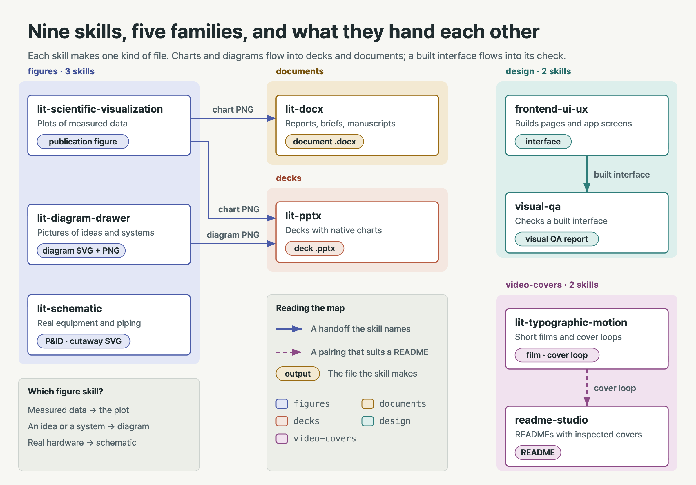
  </picture>
</p>

| Ask for | Skill (family) | You get |
| --- | --- | --- |
| A slide deck | `lit-pptx` (`decks`) | An editable `.pptx` deck |
| A report, memo or manuscript | `lit-docx` (`documents`) | A `.docx`, clean Markdown or a PDF |
| A plot of measured data | `lit-scientific-visualization` (`figures`) | A publication plot |
| A diagram of an idea or system | `lit-diagram-drawer` (`figures`) | HTML/SVG, PNG and Office-safe SVG |
| A drawing of real equipment | `lit-schematic` (`figures`) | Millimetre-sized SVG and a 600 dpi render |
| An interface | `frontend-ui-ux` (`design`) | A built interface |
| A check of a built page | `visual-qa` (`design`) | Screenshots, an evidence manifest, a QA report |
| A short film or cover loop | `lit-typographic-motion` (`video-covers`) | A film or a silent cover loop |
| A README | `readme-studio` (`video-covers`) | A factual README with its cover |

<details>
<summary>Which skill hands what to which</summary>

Chart PNGs go from `lit-scientific-visualization` to `lit-docx` and `lit-pptx`, diagram PNGs from `lit-diagram-drawer`
to `lit-pptx`, and a built interface from `frontend-ui-ux` to `visual-qa`. A `lit-typographic-motion` cover loop pairs
with `readme-studio`.

</details>

The pictures on this page are samples too. The cover at the top is a silent, seamless README cover loop, exactly the
kind of thing `video-covers` makes; the big picture, the skill map and the install paths come from
`lit-diagram-drawer`, and the plant and the manifold from `lit-schematic`.

### Quality gates

The same shelf, drawn as a process plant, shows how a request becomes a file. A request comes in on the left and goes to
the family that makes that kind of file; a draft that passes its gate leaves as the deliverable, and one that fails
goes back for another pass.

<p align="center">
  <picture>
    <source media="(prefers-color-scheme: dark)" srcset="docs/assets/schematic/skill-plant.en.dark.png">
    <source media="(prefers-color-scheme: light)" srcset="docs/assets/schematic/skill-plant.en.png">
    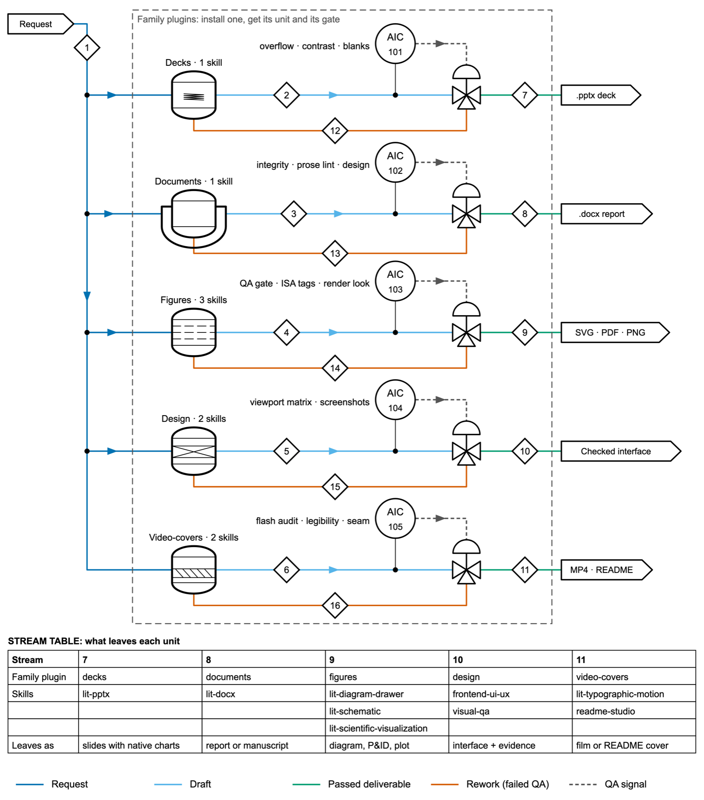
  </picture>
</p>

Each gate is built from the checks the family's skills already run. The stream table under the drawing is the whole
repository in one grid: which plugin, which skills, and what comes out.

| Family | Its gate checks |
| --- | --- |
| `decks` | Overflow and contrast |
| `documents` | Integrity and prose lint |
| `figures` | The schematic QA gate and a look at the render |
| `design` | A viewport matrix |
| `video-covers` | A flash audit and a seam check |

### `decks`

`lit-pptx` builds a finished PowerPoint deck from a request, notes or source files, with native, editable charts and
embedded Pretendard fonts. Charts can come in from `lit-scientific-visualization`, and diagrams from
`lit-diagram-drawer`.

<p align="center">
  <picture>
    <source media="(prefers-color-scheme: dark)" srcset="docs/assets/families/decks.en.dark.png">
    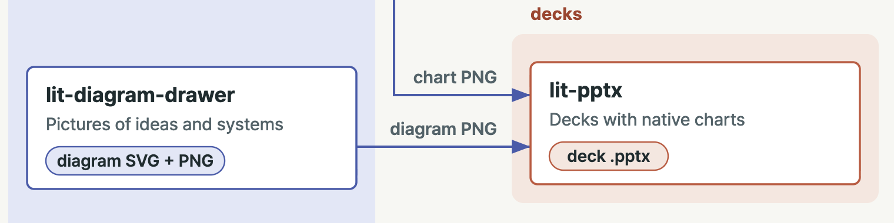
  </picture>
</p>

<details>
<summary>How lit-pptx builds a deck</summary>

1. It picks a design direction for the audience and the content first.
2. It writes the slides in Markdown and compiles them with native, editable charts and embedded Pretendard fonts.
3. A QA gate looks for overflow, weak contrast and sparse or blank slides.
4. The rendered pages get a review before the deck counts as done.

</details>

### `documents`

`lit-docx` makes a finished Word document: a report, brief, manual, proposal, memo or journal manuscript. It can also
turn DOCX or PDF into clean Markdown, edit an existing .docx in place and render a PDF.

<p align="center">
  <picture>
    <source media="(prefers-color-scheme: dark)" srcset="docs/assets/families/documents.en.dark.png">
    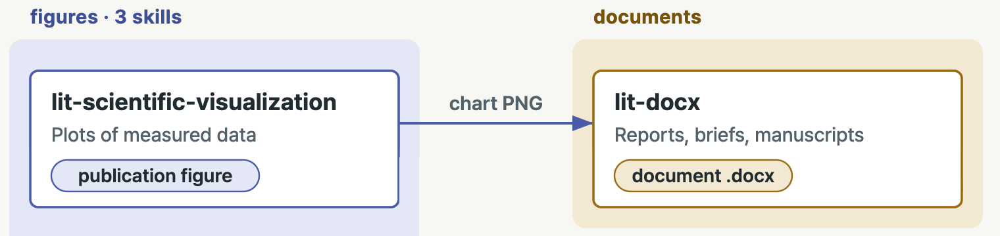
  </picture>
</p>

<details>
<summary>How lit-docx styles and checks a document</summary>

- **Styling:** it picks a tonality for the content, or follows a publisher profile you name (Elsevier, ACS, IEEE,
  Nature, or a Korean generic style).
- **Checks:** at the end it gates the result with integrity, prose and design checks on the rendered pages.

</details>

### `figures`

Every figure starts with the same question: what is the reader actually looking at? Measured data becomes a plot, an
idea or a system becomes a diagram, and real hardware becomes a schematic.

| Skill | The reader looks at | What it makes |
| --- | --- | --- |
| `lit-scientific-visualization` | Measured data | Publication plots, built on the scientific-visualization source it adapts |
| `lit-diagram-drawer` | An idea or a system | Conceptual and technical diagrams as HTML/SVG, exported as PNG and Office-safe SVG |
| `lit-schematic` | Physical equipment | Millimetre-sized SVG, with a QA gate and a 600 dpi render |

`lit-diagram-drawer` exports for slides and documents. `lit-schematic` covers P&ID, PFD, BFD, equipment layouts,
apparatus figures and isometric cutaways.

<p align="center">
  <picture>
    <source media="(prefers-color-scheme: dark)" srcset="docs/assets/families/figures.en.dark.png">
    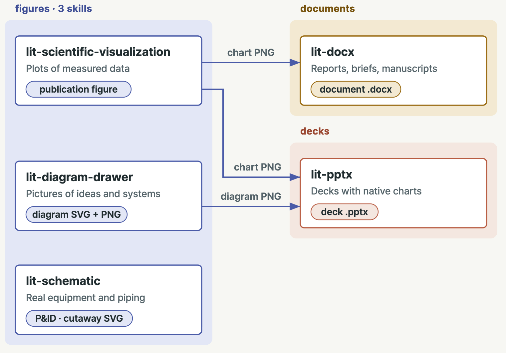
  </picture>
</p>

### `design`

`frontend-ui-ux` builds and inspects interfaces. Once a page exists, `visual-qa` takes over and verifies it.

<p align="center">
  <picture>
    <source media="(prefers-color-scheme: dark)" srcset="docs/assets/families/design.en.dark.png">
    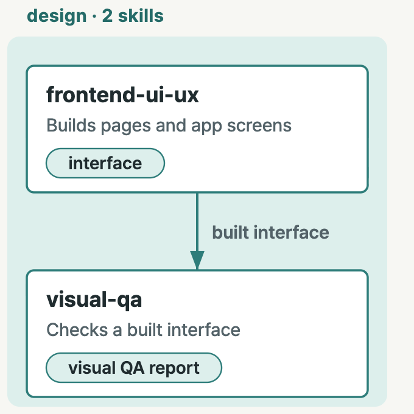
  </picture>
</p>

<details>
<summary>What sits behind each design skill</summary>

- **`frontend-ui-ux`** works from one locked house style, layout family and design kit. Behind it sit a design
  contract, a design-intelligence database and an interface probe that runs across the responsive matrix.
- **`visual-qa`** exercises the page's states at several viewport sizes, captures screenshots and writes an evidence
  manifest. When something blocks a check, it names exactly what.

</details>

### `video-covers`

`lit-typographic-motion` directs a finished short film from a one-line request, and its cover mode makes a silent,
seamless README cover loop like the one at the top of this page. `readme-studio` writes factual READMEs from the
repository itself.

<p align="center">
  <picture>
    <source media="(prefers-color-scheme: dark)" srcset="docs/assets/families/video-covers.en.dark.png">
    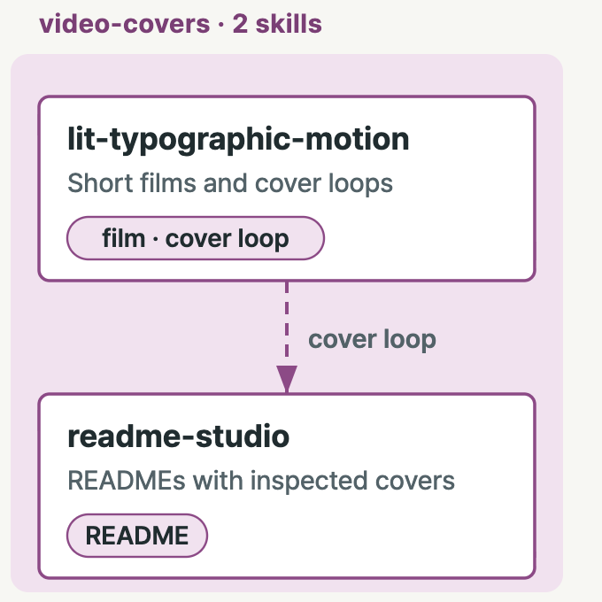
  </picture>
</p>

<details>
<summary>How a film and a README get made</summary>

- **Film steps:** `lit-typographic-motion` writes a treatment first, then runs a storyboard round you can see before
  the full render. Then come an original score, look rounds and a QA gate (flash audit, legibility, determinism, sound).
- **Film kinds:** kinetic type, lyric or quote videos, title sequences and stage films.
- **README extras:** `readme-studio` adds an inspected cover, outlined title type and, if you want one, a motion cover.

</details>

<details>
<summary>Running the film skill outside LitClaude</summary>

The moved lit-typographic-motion text was written for LitClaude, so a few of its lines describe LitClaude parts that do
not come with this plugin:
- `SKILL.md`, `references/look.md` and `references/cover.md` say a Stop hook checks the done list and holds the turn.
  That check was a LitClaude hook and does not run outside LitClaude. The skill's own `motion.mjs gate` and its done
  list still apply, and nothing ends the turn for you.
- The pre-warm used to be `litclaude-ai motion-runtime install`, which LitClaude 1.0.50 removed. The plugin now runs
  it by itself: `node <plugin>/skills/lit-typographic-motion/scripts/motion-runtime.mjs install` (or `status`), and
  `scripts/motion-doctor.mjs` prints the probes that `litclaude doctor` used to print. Every BLOCKED 14 and 15 message
  gives that line with the absolute path of the installed script. It installs into
  `${XDG_CACHE_HOME:-~/.cache}/litclaude/motion-runtime`, the cache LitClaude used, so a machine that pre-warmed it with
  LitClaude 1.0.49 or earlier needs nothing new. See [Edited after the move](#edited-after-the-move).
- `recipes/painted-light/expected.json` names a test fixture from the LitClaude repository. That fixture did not come
  along, so the recipe's reference image is only a description.

</details>

## Pick one skill for one harness

Your agent decides which of the two ways in you take, and the drawing shows both.

<p align="center">
  <picture>
    <source media="(prefers-color-scheme: dark)" srcset="docs/assets/diagrams/install-paths.en.dark.png">
    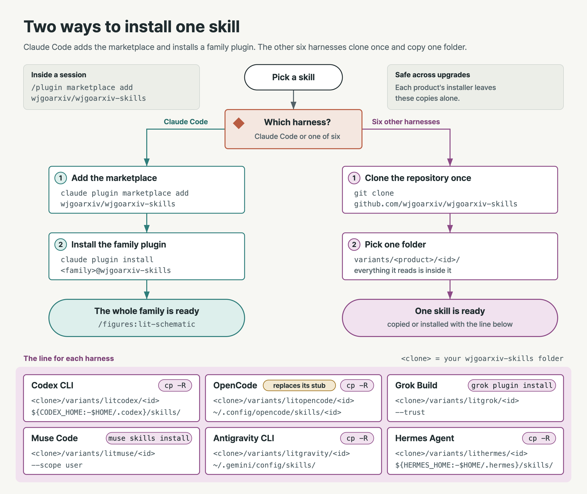
  </picture>
</p>

Find the extension in the left column. Claude Code installs the family plugin named next to it, straight from GitHub;
the other six harnesses copy that skill's own edition for their harness from a local clone.

| Skill | Family | Claude Code installs | The other six install |
| --- | --- | --- | --- |
| `lit-pptx` | `decks` | `decks@wjgoarxiv-skills` | `variants/<product>/lit-pptx/` |
| `lit-docx` | `documents` | `documents@wjgoarxiv-skills` | `variants/<product>/lit-docx/` |
| `lit-diagram-drawer` | `figures` | `figures@wjgoarxiv-skills` | `variants/<product>/lit-diagram-drawer/` |
| `lit-schematic` | `figures` | `figures@wjgoarxiv-skills` | `variants/<product>/lit-schematic/` |
| `lit-scientific-visualization` | `figures` | `figures@wjgoarxiv-skills` | `variants/<product>/lit-scientific-visualization/` |
| `frontend-ui-ux` | `design` | `design@wjgoarxiv-skills` | `variants/<product>/frontend-ui-ux/` |
| `visual-qa` | `design` | `design@wjgoarxiv-skills` | `variants/<product>/visual-qa/` |
| `lit-typographic-motion` | `video-covers` | `video-covers@wjgoarxiv-skills` | `variants/<product>/lit-typographic-motion/` |
| `readme-studio` | `video-covers` | `video-covers@wjgoarxiv-skills` | `variants/<product>/readme-studio/` |

For the other six, run `git clone https://github.com/wjgoarxiv/wjgoarxiv-skills` once, then replace
`<path to your wjgoarxiv-skills clone>` with that folder.

### One family or one folder

Claude Code installs the whole family plugin because LitClaude's copies reach into shared files next to them (`lib/`,
`vendor/`, support folders); still, only that one family gets installed. Every other harness installs one folder: its
product's own edition of the skill, which carries everything it reads inside the folder.

On OpenCode the copy takes the place of the LitOpenCode pointer folder of the same name. On the other harnesses it sits
next to its product's stub under a different name, and each product's installer leaves it alone on upgrade. Grok Build
needs the folder path itself: given a `#` subfolder of the repository instead, it copies the whole repository, `.git`
included, for each skill.

### How the lines keep your files safe

An install should never mix a new copy into an old one, or lose files you kept next to a skill, so every harness's
lines begin by looking. Where the lines copy a folder themselves, they run these four steps.

| Step | What it does | Why |
| --- | --- | --- |
| Check | Only reads, and names each same-name folder the harness would also load | Two same-name skills compete, and the harness quietly keeps one |
| Move aside | Moves an existing copy whole into a dated `extension-backups/` folder in the harness's own home | That folder sits outside every skills folder, so your files survive and never load as a second skill |
| Copy | Copies the edition into the now empty place | A new copy never lands on an old one |
| Receipt | Writes `.litfamily-extension.json` inside the copy: id, source, edition and install time | The copy records where it came from |

> [!NOTE]
> Grok Build and Muse Code keep their own install records and refuse to install over a name they already hold, so
> their lines look, move a competing copy aside and install.

No line deletes a folder, so nothing you kept is lost. Updating and removing reuse these same lines; see
[Update and remove](#update-and-remove).

### Lines for other skills

Every line on this page is shown for `lit-pptx`. They are the lines that harness's LitFamily stub gives, copied as they
are, so the stub and this page always say the same thing. For another skill, put its id where `lit-pptx` stands (and, on
Claude Code, its family where `decks` stands); the stub of that skill prints the same lines with its name filled in.

<details>
<summary>Extra notes for lit-scientific-visualization, Antigravity CLI and the OpenCode film stub</summary>

- **`lit-scientific-visualization`:** an adapter for the scientific-visualization source. The family plugin keeps that
  source in `plugins/figures/vendor/scientific-visualization/`; every edition under `variants/` carries its own copy
  inside the skill folder, so one install brings both.
- **Antigravity CLI:** the stubs also give a workspace-only form of the same copy into `.agents/skills/` (see
  [Antigravity CLI](#antigravity-cli)).
- **OpenCode film stub:** adds one runtime step after the copy:
  `node ~/.config/opencode/skills/lit-typographic-motion/runtime.mjs install`. The other editions install their engines
  on first use.

</details>

## Per-harness notes

Each harness reads skills from its own folders and settles same-name clashes its own way, so each one gets its own
lines.

| Harness | What goes in | Lines |
| --- | --- | --- |
| [Claude Code](#claude-code) | One family plugin | Check, move aside, install |
| [Codex CLI](#codex-cli) | `variants/litcodex/<id>/` | Check, move aside, copy, receipt |
| [OpenCode](#opencode) | `variants/litopencode/<id>/` | Check, move aside, copy, receipt |
| [Grok Build](#grok-build) | `variants/litgrok/<id>/` as a plugin | Two checks, install |
| [Muse Code](#muse-code) | `variants/litmuse/<id>/` | Check, move aside, install |
| [Antigravity CLI](#antigravity-cli) | `variants/litgravity/<id>/` | Check, move aside, copy, receipt |
| [Hermes Agent](#hermes-agent) | `variants/lithermes/<id>/` | Names, check, move aside, copy, receipt |

### Claude Code

Claude Code takes each family as a plugin from this marketplace, so you only install the families you actually use. The
check and install lines are in [Quick start](#quick-start).

<details>
<summary>What each step does, and what it changes</summary>

| Step | What it does | Why | Changes anything? |
| --- | --- | --- | --- |
| Check | Lists a `lit-pptx` folder in `~/.claude/skills` or a project's `.claude/skills` | Such a folder loads beside `decks:lit-pptx` and competes with it | No |
| Move aside | Moves a personal (line 2) or project (line 3) copy whole into a dated `extension-backups/` beside its `.claude` folder | Claude Code does not read that folder | Moves one folder |
| Add marketplace | Registers `wjgoarxiv/wjgoarxiv-skills` | The family plugins come from it | Yes |
| Install | Installs each family you list | You get only the families you use | Yes |

</details>

- **Inside a session:** `/plugin marketplace add wjgoarxiv/wjgoarxiv-skills`, then
  `/plugin install decks@wjgoarxiv-skills`.
- **Offline:** point the marketplace line at a local clone with
  `claude plugin marketplace add <path to your wjgoarxiv-skills clone>`.

**After install:** the skills answer as `decks:lit-pptx`, `documents:lit-docx`, `figures:lit-diagram-drawer`,
`figures:lit-schematic`, `design:frontend-ui-ux`, `design:visual-qa`, `video-covers:lit-typographic-motion` and
`video-covers:readme-studio`. LitClaude's own `lit` routing for decks, documents, figures, interfaces, films and READMEs
keeps working: when the moved skill is installed, the stub it loads points there.

> [!NOTE]
> `lit-scientific-visualization` is user-invoked only, same as it was in LitClaude, so you type
> `/figures:lit-scientific-visualization <request>`.

### Codex CLI

Codex reads skills from its own `skills` folder, from `~/.agents/skills`, and from a project's `.agents/skills` and
`.codex/skills`. It lists a same-name skill once for every folder that holds it, and it also lists a `SKILL.md` nested
inside another skill folder, which is why the copy never goes into an occupied folder.

<details>
<summary>What each step does, and what it changes</summary>

| Step | What it does | Why | Changes anything? |
| --- | --- | --- | --- |
| Check | Prints `found:` for each same-name folder in those four places | Codex would list every one of them | No |
| Move aside | Moves the copy in `${CODEX_HOME:-$HOME/.codex}/skills` to `extension-backups/<date-time>/lit-pptx` there | Codex does not read that folder | Only when a copy exists |
| Copy | Copies `variants/litcodex/lit-pptx` into the skills folder | Stops on an occupied folder | Yes |
| Receipt | Writes `.litfamily-extension.json` into the copy | Records id, source, edition and time | One file |

</details>

Run the four lines from your project folder. Each line sets its own paths, so one pasted on its own still works:

```bash
cx="${CODEX_HOME:-$HOME/.codex}"; p="$(git rev-parse --show-toplevel 2>/dev/null || pwd)"; for d in "$cx/skills" "$HOME/.agents/skills" "$p/.agents/skills" "$p/.codex/skills"; do [ -e "$d/lit-pptx" ] && echo "found: $d/lit-pptx"; done; echo "check done"
cx="${CODEX_HOME:-$HOME/.codex}"; if [ -e "$cx/skills/lit-pptx" ]; then b="$cx/extension-backups/$(date +%Y%m%d-%H%M%S)"; mkdir -p "$b" && [ ! -e "$b/lit-pptx" ] && mv "$cx/skills/lit-pptx" "$b/lit-pptx" && echo "moved aside: $b/lit-pptx"; fi
cx="${CODEX_HOME:-$HOME/.codex}"; if [ -e "$cx/skills/lit-pptx" ]; then echo "stopped: $cx/skills/lit-pptx still exists"; else mkdir -p "$cx/skills" && cp -R "<path to your wjgoarxiv-skills clone>/variants/litcodex/lit-pptx" "$cx/skills/lit-pptx"; fi
cx="${CODEX_HOME:-$HOME/.codex}"; [ -f "$cx/skills/lit-pptx/SKILL.md" ] && printf '{"id":"lit-pptx","source":"%s","variant":"litcodex","installed_at":"%s"}\n' "<path to your wjgoarxiv-skills clone>/variants/litcodex/lit-pptx" "$(date -u +%Y-%m-%dT%H:%M:%SZ)" > "$cx/skills/lit-pptx/.litfamily-extension.json"
```

**After install:** start a new Codex session.

<details>
<summary>Reading the <code>found:</code> lines</summary>

- **Under `${CODEX_HOME:-$HOME/.codex}/skills`:** that is the old copy, and the second line moves it whole to
  `${CODEX_HOME:-$HOME/.codex}/extension-backups/<date-time>/lit-pptx`.
- **Anywhere else:** a second same-name skill that Codex would also list, so move that folder out yourself.

</details>

### OpenCode

OpenCode reads `~/.config/opencode/skills`, `~/.agents/skills` and `~/.claude/skills`, plus a project's `.opencode/`,
`.agents/` and `.claude/` skills, and keeps one skill per name. The extension therefore takes the place of
LitOpenCode's pointer folder of the same name.

<details>
<summary>What each step does, and what it changes</summary>

| Step | What it does | Why | Changes anything? |
| --- | --- | --- | --- |
| Check | Lists the same-name folders OpenCode reads | Move any outside `~/.config/opencode/skills` out of the way yourself | No |
| Move aside | Moves the pointer folder whole into a dated backup | No skill loads from `extension-backups/` | Only when it exists |
| Copy | Copies `variants/litopencode/lit-pptx` in | The extension takes the pointer's place | Yes |
| Receipt | Writes `.litfamily-extension.json` into the copy | Records id, source, edition and time | One file |

</details>

Run from any folder:

```bash
ls -d ~/.config/opencode/skills/lit-pptx ~/.agents/skills/lit-pptx ~/.claude/skills/lit-pptx 2>/dev/null
d=~/.config/opencode/extension-backups/$(date +%Y%m%d-%H%M%S); [ ! -e ~/.config/opencode/skills/lit-pptx ] || { mkdir -p "$d" && mv ~/.config/opencode/skills/lit-pptx "$d/"; }
mkdir -p ~/.config/opencode/skills && cp -R "<path to your wjgoarxiv-skills clone>/variants/litopencode/lit-pptx" ~/.config/opencode/skills/lit-pptx
printf '{"id":"%s","source":"%s","variant":"litopencode","installed_at":"%s"}\n' lit-pptx "<path to your wjgoarxiv-skills clone>/variants/litopencode/lit-pptx" "$(date -u +%Y-%m-%dT%H:%M:%SZ)" > ~/.config/opencode/skills/lit-pptx/.litfamily-extension.json
```

**After install:** start a new session.

> [!NOTE]
> With `XDG_CONFIG_HOME` set, use `$XDG_CONFIG_HOME/opencode/` in place of `~/.config/opencode/`.

### Grok Build

Grok Build installs each edition as a one-skill plugin into its own plugin store and records there where it came from,
so these lines write no receipt.

<details>
<summary>What each step does, and what it changes</summary>

| Step | What it does | Why | Changes anything? |
| --- | --- | --- | --- |
| Clone | Clones this repository once | The install reads a local folder | New folder |
| Count | Counts installed `lit-pptx` copies | Above 0, skip the install: a second one stops with `already installed` | No |
| Find | Prints any personal copy in a skills folder Grok reads | It would take the bare `/lit-pptx` name ahead of LitGrok's note | No |
| Install | Installs the edition folder with `--trust` | Grok copies only that folder | Yes |

</details>

Run the two read-only checks from the project root, then the install line:

```bash
git clone https://github.com/wjgoarxiv/wjgoarxiv-skills
grok plugin list --json | grep -cF '"name": "lit-pptx"'
grep -L '^description: "Moved: lit-pptx ' {.grok,.agents,.claude,.cursor,~/.grok,~/.agents,~/.claude,~/.cursor}/skills/lit-pptx/SKILL.md 2>/dev/null
grok plugin install "<path to your wjgoarxiv-skills clone>/variants/litgrok/lit-pptx" --trust
```

If the second check printed a path, move that folder out whole first, dropping `/SKILL.md` from the printed path (the
check itself skips LitGrok's note):

```bash
mkdir -p ~/.grok/extension-backups && mv "<that folder>" "$(mktemp -d ~/.grok/extension-backups/$(date +%Y%m%d-%H%M%S)-XXXXXX)/"
```

**After install:** Grok's plugin store holds the copy, and `grok plugin update` does not copy a local folder again; see
[Update and remove](#update-and-remove).

### Muse Code

Muse can load `lit-pptx` from your Muse user skills, from `~/.claude/skills` and `~/.codex/skills` (Muse loads those
too), and from a project's `.agents/skills` and `.claude/skills`. It refuses to install over a folder that is already
there, and its `--force` merges new files into the old ones, so the lines move an occupied folder aside first.

<details>
<summary>What each step does, and what it changes</summary>

| Step | What it does | Why | Changes anything? |
| --- | --- | --- | --- |
| Check | Prints each folder Muse could load as `lit-pptx` | Same-name copies rank against the extension | No |
| Move aside | Moves your Muse copy into `extension-backups/` beside Muse's skills | Muse refuses an occupied folder | Only when it exists |
| Install | Runs `muse skills install … --scope user` | Muse's own lock records the copy | Yes |

</details>

Run from your project folder:

```bash
command ls -d "${XDG_CONFIG_HOME:-$HOME/.config}/muse/skills/lit-pptx" "$HOME/.claude/skills/lit-pptx" "$HOME/.codex/skills/lit-pptx" .agents/skills/lit-pptx .claude/skills/lit-pptx 2>/dev/null
D="${XDG_CONFIG_HOME:-$HOME/.config}/muse/skills/lit-pptx"; B="${XDG_CONFIG_HOME:-$HOME/.config}/muse/extension-backups/$(date +%Y%m%d-%H%M%S)"; [ -e "$D" ] && mkdir -p "$B" && mv "$D" "$B/" && echo "moved to $B/lit-pptx"
muse skills install <path to your wjgoarxiv-skills clone>/variants/litmuse/lit-pptx --scope user
```

**After install:** Muse records the source, the time and each file's hash in its own lock,
`$CONFIG_DIR/skills/.muse/lock.json`, so it needs no other receipt. A personal copy in `~/.claude/skills` or
`~/.codex/skills` ranks below the installed extension and shows as shadowed.

> [!WARNING]
> A project copy in `.agents/skills` or `.claude/skills` ranks above the extension inside that project, so move or
> rename that one to use the extension there.

### Antigravity CLI

agy loads skills from the workspace's `.agents/skills` and `_agents/skills`, then `~/.gemini/config/skills` and
`~/.gemini/skills`, and keeps one same-name skill without a word. A backup left inside a skills folder can even win over
the real copy, so backups go to `~/.gemini/extension-backups/`, which agy never loads.

<details>
<summary>What each step does, and what it changes</summary>

| Step | What it does | Why | Changes anything? |
| --- | --- | --- | --- |
| Check | Finds every `SKILL.md` named `lit-pptx` in those four places | agy would silently keep only one | No |
| Move aside | Moves the user copy into a dated `~/.gemini/extension-backups/` folder | agy never loads that folder | Only when it exists |
| Copy | Copies `variants/litgravity/lit-pptx` into agy's user skills | Every workspace sees them | Yes |
| Receipt | Writes `.litfamily-extension.json` into the copy | Records id, source, edition and time | One file |

</details>

Paste the four lines one at a time, in the workspace you use agy in:

```bash
find .agents/skills _agents/skills ~/.gemini/config/skills ~/.gemini/skills -maxdepth 2 -name SKILL.md -exec grep -l -E '^name: *"?lit-pptx"? *$' {} + 2>/dev/null
if [ -e ~/.gemini/config/skills/lit-pptx ] || [ -L ~/.gemini/config/skills/lit-pptx ]; then b=~/.gemini/extension-backups/$(date +%Y%m%d-%H%M%S); mkdir -p "$b" && mv ~/.gemini/config/skills/lit-pptx "$b/" && echo "moved to $b/lit-pptx"; fi
mkdir -p ~/.gemini/config/skills && [ ! -e ~/.gemini/config/skills/lit-pptx ] && cp -R "<path to your wjgoarxiv-skills clone>/variants/litgravity/lit-pptx" ~/.gemini/config/skills/lit-pptx
printf '{"id":"%s","source":"%s","variant":"litgravity","installed_at":"%s"}\n' lit-pptx "<path to your wjgoarxiv-skills clone>/variants/litgravity/lit-pptx" "$(date -u +%Y-%m-%dT%H:%M:%SZ)" > ~/.gemini/config/skills/lit-pptx/.litfamily-extension.json
```

**After install:** start a new conversation, or type `/skills reload`.

<details>
<summary>Install for one workspace only</summary>

Run line one above, then these three in the workspace root:

```bash
if [ -e .agents/skills/lit-pptx ] || [ -L .agents/skills/lit-pptx ]; then b=~/.gemini/extension-backups/$(date +%Y%m%d-%H%M%S)-project; mkdir -p "$b" && mv .agents/skills/lit-pptx "$b/" && echo "moved to $b/lit-pptx"; fi
mkdir -p .agents/skills && [ ! -e .agents/skills/lit-pptx ] && cp -R "<path to your wjgoarxiv-skills clone>/variants/litgravity/lit-pptx" .agents/skills/lit-pptx
printf '{"id":"%s","source":"%s","variant":"litgravity","installed_at":"%s"}\n' lit-pptx "<path to your wjgoarxiv-skills clone>/variants/litgravity/lit-pptx" "$(date -u +%Y-%m-%dT%H:%M:%SZ)" > .agents/skills/lit-pptx/.litfamily-extension.json
```

</details>

### Hermes Agent

Hermes reads skills from the profile's `skills/` folder (category folders inside it included), from a trusted project's
`.hermes/skills` and `.agents/skills`, and from any `external_dirs` you set.

<details>
<summary>What each step does, and what it changes</summary>

| Step | What it does | Why | Changes anything? |
| --- | --- | --- | --- |
| Names | Sets `H`, `ID` and `SRC` | The other lines use them, so paste all lines together | No |
| Check | Prints `taken:` or `free:`, same-name skills, and your `external_dirs` settings | Shows what would clash | No |
| Move aside | Moves the folder into the profile's `extension-backups/<date-time>/` | Acts only when the folder exists | Only then |
| Copy | Copies the edition into an empty `skills/lit-pptx/` | Stops if the folder is still there | Yes |
| Receipt | Writes `.litfamily-extension.json` into the copy | Records id, source, edition and time | One file |

</details>

Paste the lines together from the project's top folder, in bash or zsh:

```bash
H="${HERMES_HOME:-$HOME/.hermes}"; ID=lit-pptx; SRC="<path to your wjgoarxiv-skills clone>/variants/lithermes/lit-pptx"
[ -e "$H/skills/${ID:?}" ] && echo "taken: $H/skills/$ID" || echo "free: $H/skills/$ID"; grep -rlE --include=SKILL.md "^name: *[\"']?${ID}[\"']? *\$" "$H/skills" .hermes/skills .agents/skills 2>/dev/null; grep -A3 -E '^ *(external_dirs|create_dir):' "$H/config.yaml" 2>/dev/null
if [ -e "$H/skills/${ID:?}" ]; then mkdir -p "$H/extension-backups" && B=$(mktemp -d "$H/extension-backups/$(date +%Y%m%d-%H%M%S)-XXXX") && mv "$H/skills/$ID" "$B/" && echo "moved aside: $B/$ID"; fi
if [ -e "$H/skills/${ID:?}" ]; then echo "stopped: $H/skills/$ID is still there"; else mkdir -p "$H/skills" && cp -R "$SRC" "$H/skills/$ID" && echo "copied: $H/skills/$ID"; fi
printf '{"id":"%s","source":"%s","variant":"lithermes","installed_at":"%s"}\n' "${ID:?}" "$SRC" "$(date -u +%Y-%m-%dT%H:%M:%SZ)" > "$H/skills/$ID/.litfamily-extension.json"
```

**After install:** the copy's `.litfamily-extension.json` records where it came from.

> [!WARNING]
> Two different copies of one name under `skills/` tie, and Hermes then loads neither.

## How it works

<p align="center">
  <picture>
    <source media="(prefers-color-scheme: dark)" srcset="docs/assets/diagrams/big-picture.en.dark.png">
    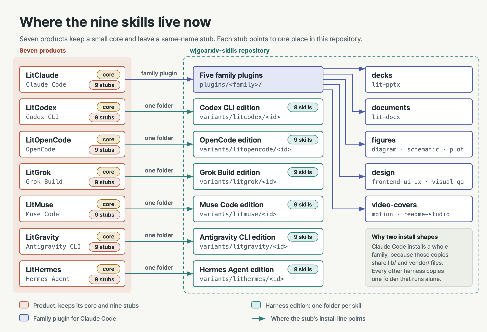
  </picture>
</p>

Every LitFamily product kept its core, plus one stub for each skill that moved out, and every stub points to one place
in this repository. LitClaude's stubs point to the five family plugins; the six other products point to their own
edition under `variants/<product>/<id>/`, one self-contained folder per skill.

### Why the skills moved here

These skills grew into the heaviest part of every LitFamily product: a deck builder with its own office runtime, a
document studio, three kinds of figure, an interface kit and a film engine. Most people did not need all of that on
every install, so the core stayed light and complete on its own, and these skills moved here unchanged. Install one
beside your LitFamily product for the full LitFamily experience: the same-name stub finds it by name and hands it the
work.

The repository is public at https://github.com/wjgoarxiv/wjgoarxiv-skills.

### Family plugins and their sources

The family plugins hold LitClaude's copies, which were written for Claude Code and moved unchanged.

<details>
<summary>The LitClaude commit each family plugin came from</summary>

| Plugin | Moved from LitClaude |
| --- | --- |
| `decks` | `fc0fe5d` (1.0.48) |
| `documents` | `8c736ce` (1.0.49 plus the decks move) |
| `figures` | `2381bfe` (files identical to 1.0.49) |
| `design` | `aaea364` (files identical to 1.0.49) |
| `video-covers` | `4d03ca8` (files identical to 1.0.49) |

</details>

### Editions under `variants/`

Before the move, the six other products each shipped their own edition of the same nine skills, written for their own
harness. It is easiest to picture the repository as a tank and each harness as a branch off one header: Claude Code
draws the whole family, and every other branch draws one folder from its own edition.

<p align="center">
  <picture>
    <source media="(prefers-reduced-motion: reduce) and (prefers-color-scheme: dark)" srcset="docs/assets/schematic/editions-manifold.en.dark.png">
    <source media="(prefers-reduced-motion: reduce)" srcset="docs/assets/schematic/editions-manifold.en.png">
    <source media="(prefers-color-scheme: dark)" srcset="docs/assets/schematic/editions-manifold-loop.en.dark.webp">
    <source media="(prefers-color-scheme: light)" srcset="docs/assets/schematic/editions-manifold-loop.en.webp">
    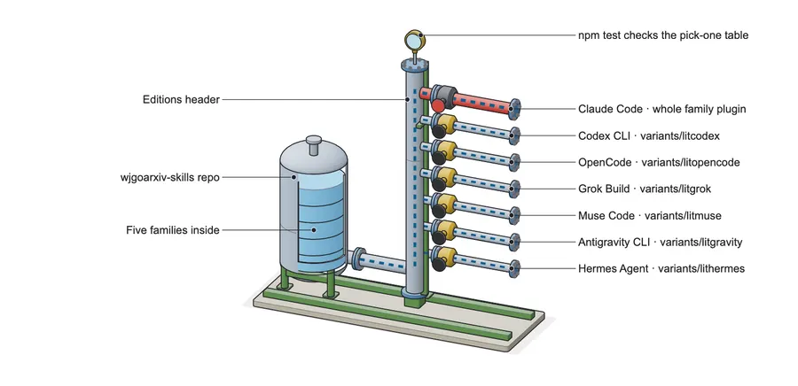
  </picture>
</p>

Each edition first came in unchanged under `variants/<product>/<id>/`, copied byte for byte from the product commit that
last shipped it, with one receipt per product in `receipts/variants-<product>.sha256`. One more commit per product then
made its folders work on their own, and `variants/<product>/CHANGES.md` lists each change and the reason for it.

<details>
<summary>The product commit each edition was copied from</summary>

| Folder | Harness | Copied from |
| --- | --- | --- |
| `variants/litcodex/` | Codex CLI | LitCodex `b82ad1c` (1.0.38 plus the skills lock), `plugins/litcodex/skills/<id>/` |
| `variants/litopencode/` | OpenCode | LitOpenCode `dc56845` (1.0.43 plus the skills lock), `skills/<id>/` |
| `variants/litgrok/` | Grok Build | LitGrok `8fd2c96` (1.0.34 plus the skills lock), `.grok/skills/<id>/` |
| `variants/litgravity/` | Antigravity CLI | LitGravity `9f2533c` (0.1.8 plus the skills lock), `plugin/skills/<id>/` |
| `variants/litmuse/` | Muse Code | LitMuse `e966b07` (0.1.11 plus the skills lock), `plugin/skills/<id>/` |
| `variants/lithermes/` | Hermes Agent | LitHermes `a2466f2` (1.0.39 plus the skills lock), `packages/lithermes-installer/assets/lithermes-plugin/skills/<id>/` |

</details>

<details>
<summary>What that commit changed, and what stayed</summary>

- **What the editions leaned on:** inside its product, each edition leaned on things a one-folder install does not
  bring along: runtime commands, environment variables, hooks and done gates, doctor lines, agent definitions, and
  files in sibling skills or in the product's shared `lib/` and `vendor/` folders.
- **What changed:** the commit copies the files a skill reads into its folder, swaps product commands for scripts inside
  the folder, and drops every path that leads outside the folder.
- **What stayed:** the procedures, references, engines and QA gates. The Codex edition dropped the tests that drove
  LitCodex's plugin internals.
- **Internal names kept on purpose:** measured expectations or saved files depend on them. These are schema ids such as
  `litfamily.*` and the product-prefixed ones, the brand word in sample cover recipes, and (in the Codex edition) the
  `LITCODEX_*` knobs and error codes of its own scripts.
- **Third-party corpora pinned by hash:** such as frontend-ui-ux's `references/_canonical-corpus/`, are left as they
  came and may name other coding agents.

</details>

## Update and remove

Updating means running the same lines again, and removing a copy usually means moving it aside, so a removed copy
waits in its backups folder. Claude Code and Grok Build update through their own commands, and Hermes Agent removes
with one more line; all three sit under the table.

| Harness | Update | Remove |
| --- | --- | --- |
| Claude Code | Refresh the marketplace, then update the family | `claude plugin uninstall decks@wjgoarxiv-skills` |
| Codex CLI | Pull the clone, run the four lines again | Run only the move-aside line |
| OpenCode | Run the four lines again | Run the second line; `litopencode install` then brings the pointer back |
| Grok Build | Pull, uninstall once per counted copy, install again | `grok plugin uninstall lit-pptx`; the clone keeps the source |
| Muse Code | Run the three lines again | Run the second line, then `muse skills uninstall lit-pptx` |
| Antigravity CLI | Run the same lines again | Run the second line alone |
| Hermes Agent | Pull the clone, paste the same lines again | Paste the first line, then the remove line below |

Afterwards, restart as the harness's **After install** line says (Claude Code: `/reload-plugins`); Grok Build, Muse Code
and Hermes Agent need no restart.

<details>
<summary>The update lines for Claude Code and Grok Build, and the Hermes Agent remove line</summary>

**Claude Code.** Run the two lines in this order. The first refreshes the marketplace, and the second compares the
plugin's version against what it fetched. Claude Code installs a new copy only when that version has changed, and
the new copy loads after `/reload-plugins`.

```bash
claude plugin marketplace update wjgoarxiv-skills
claude plugin update decks@wjgoarxiv-skills
```

**Grok Build.** A second install of the same folder stops with `already installed`, so uninstall once for each copy the
first check counted. Run from any folder:

```bash
git -C "<path to your wjgoarxiv-skills clone>" pull
grok plugin uninstall lit-pptx
grok plugin install "<path to your wjgoarxiv-skills clone>/variants/litgrok/lit-pptx" --trust
```

**Hermes Agent.** To remove the copy, paste the first Hermes line, then this one. It moves the folder into the backups
and deletes nothing:

```bash
[ -e "$H/skills/${ID:?}" ] && mkdir -p "$H/extension-backups" && B=$(mktemp -d "$H/extension-backups/$(date +%Y%m%d-%H%M%S)-XXXX") && mv "$H/skills/$ID" "$B/" && echo "moved aside: $B/$ID"
```

</details>

- **Antigravity CLI:** an update moves the old copy to a new dated backup and rewrites the receipt. Clear old backups
  out of `~/.gemini/extension-backups/` when you no longer need them.

> [!WARNING]
> On Muse Code, leave out `--force` and `muse skills update lit-pptx` when updating: both keep files a newer edition
> dropped.

## Troubleshooting and FAQ

**Do I need a LitFamily product?** No. Each family plugin works with no LitFamily product installed; with one, its
routing finds the moved skill by name.

**Why do the skills keep their `lit-` names?** The prefix is just a name tag that records where a skill came from, and
you need nothing called lit to use it. Each product's stub carries the same id so its routing finds the moved skill, and
renaming here would break that link and stop the receipts that prove each copy is unchanged from matching.

**My harness loads a different copy.** Two same-name skills compete and the harness quietly keeps one. Run your
harness's check line and move the other folder aside.

**The film skill mentions a Stop hook I do not have.** That hook belonged to LitClaude; see
[Running the film skill outside LitClaude](#video-covers).

## Reference

This part is for maintaining the repository, and a first-time user can skip it. The longer inventories live in
[docs/reference.md](docs/reference.md).

| Topic | Where |
| --- | --- |
| Repository layout | [docs/reference.md › Repository layout](docs/reference.md#repository-layout) |
| What each family plugin carries beyond its skills | [docs/reference.md › What each family carries](docs/reference.md#what-each-family-carries) |
| Rules for this repository | [docs/reference.md › Rules for this repository](docs/reference.md#rules-for-this-repository) |
| Files edited after the move | [Edited after the move](#edited-after-the-move) |
| What `npm test` checks | [Check](#check) |

### Edited after the move

A moved file stays as it came, with one exception: a line that tells you (or the model) to run a LitFamily product
command the product has since removed. Such a line is changed to a command the installed plugin runs by itself, and
nothing else in the file changes.

<details>
<summary>The edited files, family by family</summary>

The edited files keep their receipt row, which then carries the current sha256 first and
`edited-from:<sha256 of the unchanged copy>` as a fourth field; `npm test` checks both and checks that this list names
every edited file. The cache paths stay the same, so a runtime an older product release installed is reused.

`video-covers` (LitClaude 1.0.50 removed `litclaude-ai motion-runtime` and the motion doctor lines):
- `skills/lit-typographic-motion/engine/node/runtime.mjs`: `INSTALL_COMMAND`, which every BLOCKED 14 and 15 message,
  the status and the doctor print, is `node "<absolute skill dir>/scripts/motion-runtime.mjs" install`.
- `skills/lit-typographic-motion/engine/node/stage-serve.mjs`: its two stage-font BLOCKED messages print that command.
- `skills/lit-typographic-motion/scripts/motion-runtime.mjs`: the usage text names the script itself.
- `skills/lit-typographic-motion/SKILL.md`: the exit 14 row.
- `skills/lit-typographic-motion/references/runtime.md`: the install table, the pre-warm section (pre-warm, doctor and
  status by script), the exit 14 row and the audio warning.
- `skills/lit-typographic-motion/engine/audio/beat_grid.py`, `skills/lit-typographic-motion/fonts/manifest.json`,
  `skills/lit-typographic-motion/engine/models/word-timing.json` and
  `skills/lit-typographic-motion/engine/THIRD_PARTY_NOTICES`: the line that names the installer.

Two files still name the old command on purpose: `engine/package.json` and `engine/audio/requirements.lock`. Their
bytes are hashed into the cache folder names (`node-<lockdigest>-...` and `audio-<digest>`), so editing them would
throw away every cache already on disk.

`figures` (LitClaude 1.0.50 removed the scientific-visualization doctor from `litclaude doctor`):
- `skills/lit-scientific-visualization/SKILL.md`: step 4 runs only the bundled doctor and no longer offers
  `litclaude doctor`.

`decks` and `documents` need no edit: the office runtime installs itself on first use from `lib/office-runtime.mjs`,
and its `status` runs from the plugin. The editions under `variants/` were already made to run on their own (see each
`CHANGES.md`); none of them names a command its product removed.

</details>

### Check

`npm test` guards what this page promises, so run it with the plugin validators after any change.

<details>
<summary>What <code>npm test</code> checks, and the validator lines</summary>

| `npm test` checks | Against |
| --- | --- |
| One pick-one row for every skill a family plugin ships | The marketplace |
| The per-harness lines, word for word | `test/stub-install-lines.json`, the lines each stub gives |
| Every folder those lines name, for every skill | This repository |
| Every receipt, including `edited-from:` rows | The copied bytes |

Run from the repository root:

```bash
npm test
claude plugin validate .
claude plugin validate plugins/decks
claude plugin validate plugins/documents
claude plugin validate plugins/figures
claude plugin validate plugins/design
claude plugin validate plugins/video-covers
```

</details>

## Licences

This repository has no single licence of its own. Each family plugin carries the licence its files came under, in
`plugins/<family>/LICENSE`, and declares it in its `plugin.json`. Every plugin is MIT; `design` adds Apache-2.0 and
`video-covers` adds OFL-1.1.

<details>
<summary>Each plugin's licence and where it comes from</summary>

| Plugin | Declared licence | Where it comes from |
| --- | --- | --- |
| `decks` | MIT | LitClaude's own files |
| `documents` | MIT | LitClaude's own files |
| `figures` | MIT | LitClaude's own files; the copies under `vendor/` keep their own provenance and licence files |
| `design` | MIT AND Apache-2.0 | frontend-ui-ux's `LICENSE` (MIT) and `THIRD-PARTY-NOTICE.txt` cover its design data, and its `references/_canonical-corpus/legal/` holds the Apache-2.0 licence of the reference corpus |
| `video-covers` | MIT AND OFL-1.1 | LitClaude's own files, plus the Pretendard fonts under their OFL licence |

</details>

The Pretendard and JetBrains Mono fonts travel unmodified, each with its OFL licence file. The editions under
`variants/` keep the licence and font-licence files their products shipped inside each skill folder. The images in
`docs/assets/` were made for this page, and the fonts in them appear only as rendered pixels.
