<p align="right"><a href="README.md">English</a> · <b>한국어</b></p>

<p align="center">
  <a href="docs/assets/cover/cover-dark.mp4">
    <picture>
      <source media="(prefers-reduced-motion: reduce) and (prefers-color-scheme: dark)" srcset="docs/assets/cover/poster-dark.webp">
      <source media="(prefers-reduced-motion: reduce)" srcset="docs/assets/cover/poster-light.webp">
      <source media="(prefers-color-scheme: dark)" srcset="docs/assets/cover/cover-dark.webp">
      <source media="(prefers-color-scheme: light)" srcset="docs/assets/cover/cover-light.webp">
      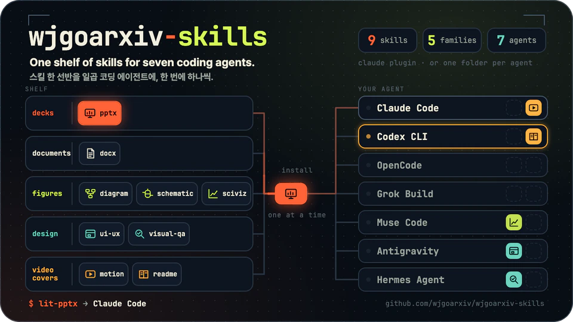
    </picture>
  </a>
</p>

<p align="center">
  <b>스킬 한 선반을 일곱 코딩 에이전트에, 한 번에 하나씩.</b><br>
  발표자료, 문서, 그림, 화면, 영상, README까지. 패밀리 단위로도, 폴더 하나 단위로도 설치할 수 있습니다.<br>
  <sub>소리 없는 커버 영상: <a href="docs/assets/cover/cover-dark.mp4">어두운 테마 MP4</a> · <a href="docs/assets/cover/cover-light.mp4">밝은 테마 MP4</a></sub>
</p>

# wjgoarxiv-skills

여기 있는 스킬 아홉 개는 LitFamily 안에서 자랐습니다. LitFamily는 계획, 루프, 목표, 리뷰로 이어지는 같은 작업 방식을
일곱 코딩 에이전트에 붙여 주는 애드온 묶음입니다. 그런데 시간이 지나면서 이 스킬들이 제품마다 가장 무거운 부분이
되었습니다. 자체 오피스 런타임을 가진 발표자료 빌더, 문서 스튜디오, 세 종류의 그림 도구, 화면 디자인 키트, 영상
엔진까지 들어 있었으니까요. 설치할 때마다 이걸 전부 받을 필요가 없는 사람이 대부분이었고, LitFamily 없이 딱 하나만
쓰고 싶다는 사람도 있었습니다. 그래서 스킬들을 한 글자도 고치지 않고 이곳으로 옮겼습니다. 각 LitFamily 제품에는 같은
이름의 작은 스텁만 남아, 그 스킬이 무엇을 하는지와 이 선반에서 어떻게 설치하는지를 알려 줍니다. 이 저장소는 LitFamily
제품이 없어도 그대로 쓸 수 있습니다. 지금 쓰는 에이전트에 필요한 스킬 하나만 골라 가시면 됩니다.

저장소 주소는 https://github.com/wjgoarxiv/wjgoarxiv-skills 입니다.

## 전체 그림

LitFamily 제품들은 핵심 스킬은 그대로 두고, 옮겨 간 스킬마다 스텁을 하나씩 남겼습니다. 스텁은 모두 이 저장소의 한
곳을 가리키는데, 어디를 가리키는지는 하네스마다 다릅니다. LitClaude의 스킬은 옆에 있는 공용 파일(`lib/`, `vendor/`,
보조 폴더)에 기대기 때문에, Claude Code에서는 패밀리 플러그인을 통째로 설치합니다. 나머지 여섯 제품은 같은 아홉
스킬을 각자의 하네스에 맞게 다시 쓴 에디션을 갖고 있었고, 그 에디션이 지금은 `variants/<product>/<id>/` 아래에
스킬마다 혼자 돌아가는 폴더 하나씩으로 들어 있습니다.

<p align="center">
  <picture>
    <source media="(prefers-color-scheme: dark)" srcset="docs/assets/diagrams/big-picture.ko.dark.png">
    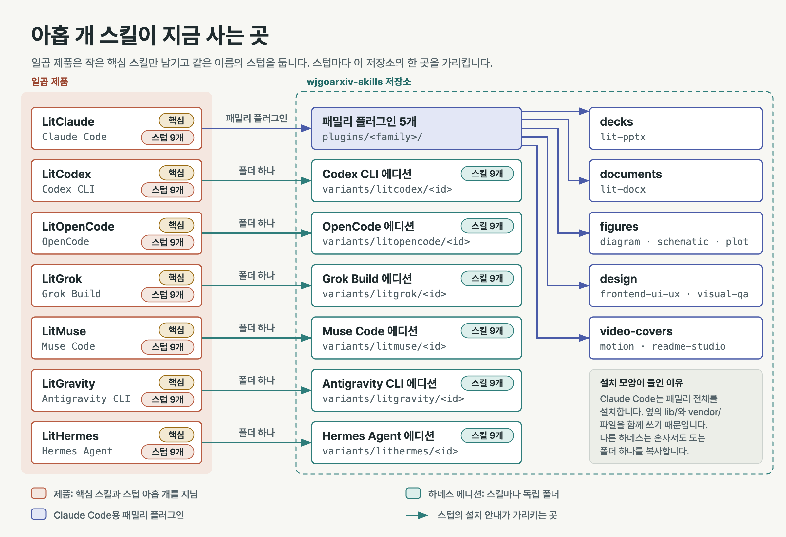
  </picture>
</p>

## 안을 들여다보면: 요청 하나, 유닛 다섯, 관문 다섯

같은 선반을 공정 플랜트로 그려 보았습니다. 왼쪽에서 들어온 요청은 그 파일을 만드는 패밀리로 갑니다. 패밀리마다
품질 관문이 하나씩 있는데, 스킬이 원래 하던 검사를 그대로 옮긴 것입니다. 발표자료는 넘침과 대비를, 문서는 무결성과
문장 린트를, 그림은 도면 QA 게이트와 렌더 확인을, 화면은 뷰포트 매트릭스를, 영상은 섬광 검사와 이음새를 봅니다.
통과한 초안은 산출물로 나가고, 걸린 초안은 다시 작업하러 돌아갑니다. 아래 스트림 표를 보면 어떤 플러그인에 어떤
스킬이 들어 있고 무엇이 나오는지 저장소 전체가 한눈에 들어옵니다.

<p align="center">
  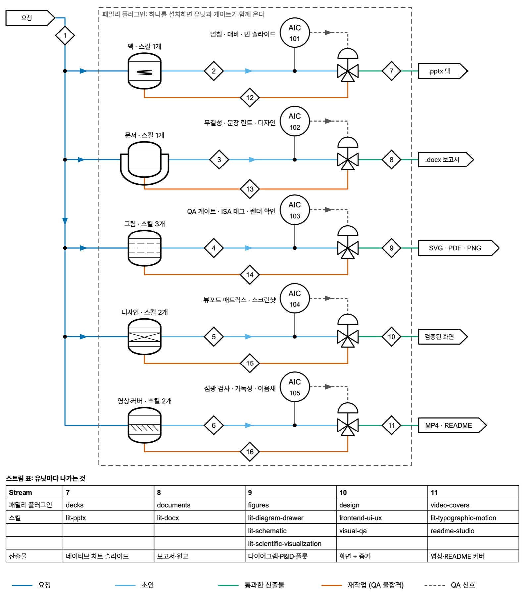
</p>

## 다섯 패밀리

스킬은 저마다 한 종류의 파일을 만들고, 그중 몇몇은 만든 것을 다른 스킬에 넘겨 줍니다. 차트와 다이어그램은 발표자료와
문서로 들어가고, 완성된 화면은 점검으로 넘어갑니다. 지도의 화살표는 스킬의 `SKILL.md`가 직접 그 연결을 말하는
곳에만 그렸습니다. 점선 하나는 README에 잘 어울리는 짝이라서 이어 둔 것입니다.

<p align="center">
  <picture>
    <source media="(prefers-color-scheme: dark)" srcset="docs/assets/diagrams/skill-map.ko.dark.png">
    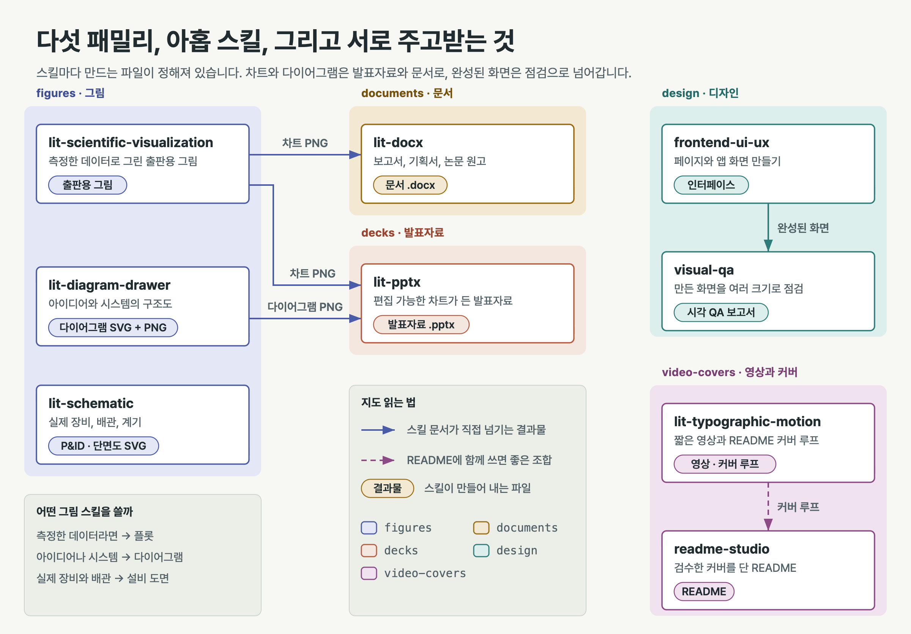
  </picture>
</p>

이 페이지의 그림들이 곧 견본이기도 합니다. 맨 위 커버는 `video-covers`가 만드는 것과 같은 종류인, 소리 없이 끊김 없이
반복되는 README 커버 루프입니다. 전체 그림, 스킬 지도, 설치 경로는 `lit-diagram-drawer`로, 공정 플랜트와 매니폴드는
`lit-schematic`으로 그리고 내보냈습니다.

### `decks`: 받은 사람이 고칠 수 있는 발표자료

`lit-pptx`는 요청이나 메모, 원본 파일을 받아 완성된 PowerPoint 발표자료를 만듭니다. 먼저 청중과 내용에 맞는 디자인
방향을 정하고, 슬라이드를 Markdown으로 쓴 뒤, 편집 가능한 네이티브 차트와 Pretendard 글꼴을 넣어 컴파일합니다.
QA 게이트가 넘치는 글, 약한 대비, 비어 있거나 허전한 슬라이드를 찾아내고, 렌더링한 페이지를 직접 확인한 뒤에야
완성으로 봅니다. 차트는 `lit-scientific-visualization`에서, 다이어그램은 `lit-diagram-drawer`에서 받아 쓸 수 있습니다.

<p align="center">
  <picture>
    <source media="(prefers-color-scheme: dark)" srcset="docs/assets/families/decks.ko.dark.png">
    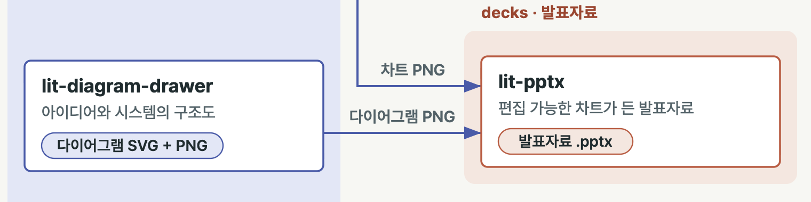
  </picture>
</p>

LitClaude `fc0fe5d`(1.0.48)에서 옮겼습니다.

### `documents`: 디자인한 티가 나는 워드 문서

`lit-docx`는 보고서, 브리프, 매뉴얼, 제안서, 메모, 학술지 원고 같은 워드 문서를 완성본으로 만듭니다. 문체와 디자인은
내용에 맞춰 고르거나, 지정한 출판사 양식(Elsevier, ACS, IEEE, Nature, 한국어 일반 양식)을 따릅니다. DOCX나 PDF를
깔끔한 Markdown으로 바꾸고, 기존 .docx를 그 자리에서 고치고, PDF로 렌더링하는 일도 합니다. 마지막에는 렌더링한
페이지를 놓고 무결성, 문장, 디자인을 검사합니다.

<p align="center">
  <picture>
    <source media="(prefers-color-scheme: dark)" srcset="docs/assets/families/documents.ko.dark.png">
    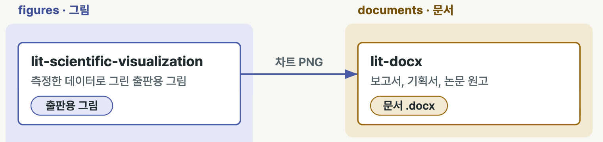
  </picture>
</p>

LitClaude `8c736ce`(1.0.49와 decks 이전분)에서 옮겼습니다.

### `figures`: 세 종류의 그림, 세 개의 스킬

그림을 그릴 때는 먼저 "읽는 사람이 무엇을 보게 되는가"를 묻습니다. 측정한 데이터라면 플롯이, 아이디어나 시스템이라면
다이어그램이, 실제 장비라면 도면이 맞습니다. `lit-scientific-visualization`은 원본 scientific-visualization 스킬을
바탕으로 측정 데이터를 논문용 플롯으로 그립니다. `lit-diagram-drawer`는 개념도와 기술 다이어그램을 HTML/SVG로 그리고,
발표자료와 문서에 넣을 PNG와 Office 호환 SVG로 내보냅니다. `lit-schematic`은 P&ID, PFD, BFD, 장비 배치도, 실험 장치도,
아이소메트릭 단면도 같은 실물 장비 도면을 밀리미터 단위 SVG로 그리고, QA 게이트와 600 dpi 렌더까지 거칩니다.

<p align="center">
  <picture>
    <source media="(prefers-color-scheme: dark)" srcset="docs/assets/families/figures.ko.dark.png">
    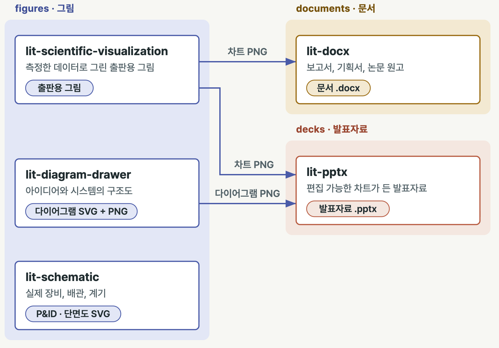
  </picture>
</p>

LitClaude `2381bfe`(파일은 1.0.49와 같음)에서 옮겼습니다.

### `design`: 화면을 만들고, 만든 화면을 점검하고

`frontend-ui-ux`는 하나로 고정한 하우스 스타일, 레이아웃 계열, 디자인 키트를 바탕으로 화면을 만들고 살펴봅니다. 디자인
계약, 디자인 지식 데이터베이스, 그리고 반응형 매트릭스 전체를 훑는 인터페이스 프로브가 함께 움직입니다. 화면이 만들어진
다음에는 `visual-qa`가 확인을 맡습니다. 여러 뷰포트 크기에서 상태를 하나하나 바꿔 보며 스크린샷을 찍고, 증거 목록을
남기고, 확인을 막는 것이 있으면 무엇이 막았는지 정확히 짚어 줍니다.

<p align="center">
  <picture>
    <source media="(prefers-color-scheme: dark)" srcset="docs/assets/families/design.ko.dark.png">
    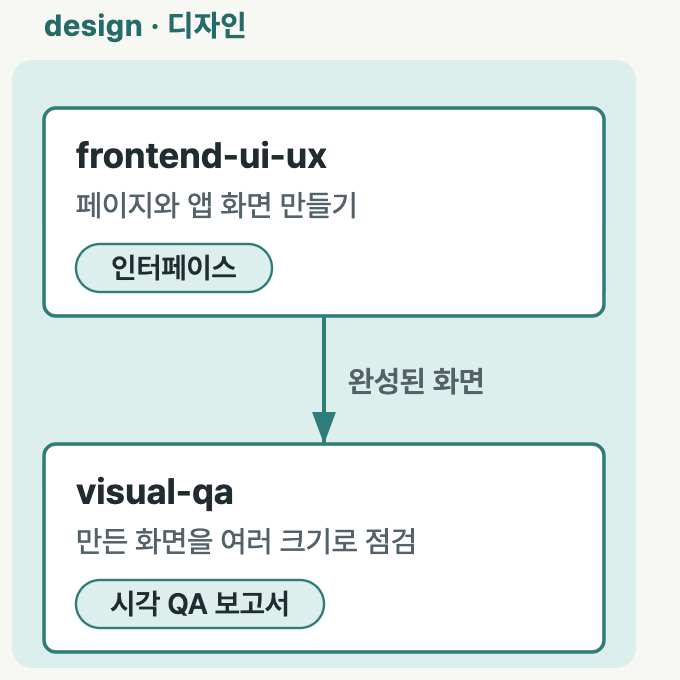
  </picture>
</p>

LitClaude `aaea364`(파일은 1.0.49와 같음)에서 옮겼습니다.

### `video-covers`: 짧은 영상과, 그 영상이 걸릴 README

`lit-typographic-motion`은 한 줄짜리 요청에서 출발해 짧은 영상을 끝까지 연출합니다. 먼저 트리트먼트를 쓰고, 본 렌더
전에 눈으로 확인할 수 있는 스토리보드 단계를 거치고, 직접 만든 음악과 룩 조정, 그리고 섬광, 가독성, 결정성, 소리를
보는 QA 게이트를 지납니다. 키네틱 타이포그래피, 가사나 인용구 영상, 타이틀 시퀀스, 무대형 영상을 만들 수 있고, 커버
모드로는 이 페이지 맨 위에 있는 것처럼 소리 없이 끊김 없이 반복되는 README 커버 루프를 만듭니다. `readme-studio`는
저장소를 직접 읽어 사실에 맞는 README를 쓰고, 검수한 커버와 윤곽선으로 바꾼 제목 글자, 원하면 움직이는 커버까지 붙입니다.

<p align="center">
  <picture>
    <source media="(prefers-color-scheme: dark)" srcset="docs/assets/families/video-covers.ko.dark.png">
    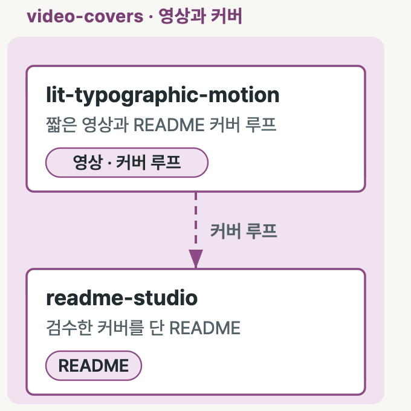
  </picture>
</p>

LitClaude `4d03ca8`(파일은 1.0.49와 같음)에서 옮겼습니다.

## 하네스별로 스킬 하나 설치하기

설치하는 길은 두 가지이고, 어느 쪽으로 갈지는 쓰는 에이전트가 정합니다. Claude Code는 이 마켓플레이스를 추가하고
패밀리 플러그인을 설치합니다. 나머지 하네스는 저장소를 한 번 클론한 뒤 폴더 하나만 옮깁니다.

<p align="center">
  <picture>
    <source media="(prefers-color-scheme: dark)" srcset="docs/assets/diagrams/install-paths.ko.dark.png">
    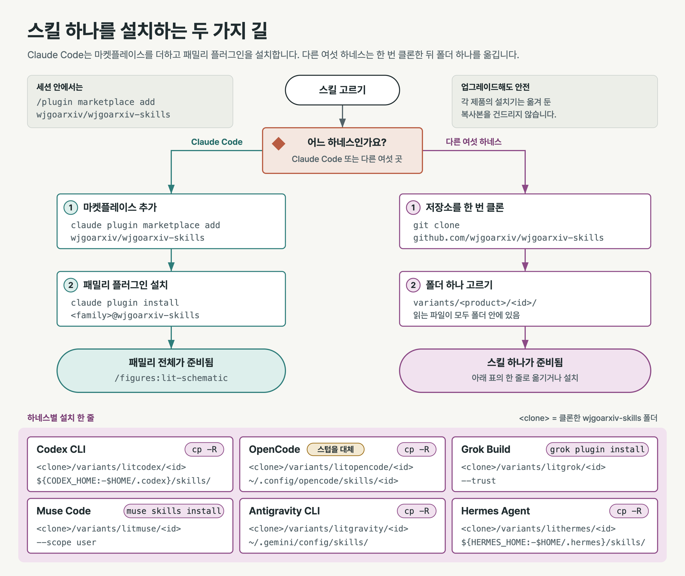
  </picture>
</p>

왼쪽 열에서 스킬을, 맨 위 줄에서 쓰는 하네스를 찾으세요. 칸에 적힌 명령은 그 하네스의 LitFamily 스텁이 안내하는 설치
명령을 그대로 옮긴 것이라, 스텁과 이 표는 언제나 같은 말을 합니다. Claude Code는 GitHub에서 바로 설치합니다. 다른
하네스는 로컬 클론에서 복사하므로, 먼저 `git clone https://github.com/wjgoarxiv/wjgoarxiv-skills`를 한 번 실행하고
`<path to your wjgoarxiv-skills clone>` 자리에 그 폴더 경로를 넣으면 됩니다. Grok Build 칸에 클론 명령이 함께 있는
것은 LitGrok 안내문이 그렇게 적고 있기 때문입니다.

Claude Code에서 패밀리 플러그인을 통째로 설치하는 이유는 LitClaude판 스킬이 옆에 있는 공용 파일(`lib/`, `vendor/`,
보조 폴더)을 읽기 때문입니다. 그래도 설치되는 것은 그 패밀리 하나뿐입니다. 다른 하네스는 폴더 하나만 설치합니다. 각
제품이 만든 자기 에디션을 `variants/<product>/<id>/`에서 가져가며, 이 폴더에는 스킬이 읽는 파일이 모두 들어 있습니다.
Grok Build는 폴더 경로를 스킬 하나짜리 플러그인으로 받아 그 폴더만 플러그인 저장소로 복사합니다. 저장소의 `#`
하위 폴더 형식으로 주면 스킬마다 `.git`까지 포함한 저장소 전체를 복사하므로 그 형식은 쓰지 않습니다. Muse Code는
`muse skills install`로 설치하고, Codex CLI, OpenCode, Antigravity CLI, Hermes Agent는 각자의 스킬 폴더에 복사합니다.
OpenCode 명령은 같은 이름의 LitOpenCode 스텁 폴더를 바꿔 끼웁니다. 다른 하네스에서는 복사본이 제품 스텁 옆에 다른
이름으로 자리 잡고, 제품 설치 프로그램은 업그레이드할 때 이 폴더를 건드리지 않습니다.

| 스킬 | 패밀리 | Claude Code | Codex CLI | OpenCode | Grok Build | Muse Code | Antigravity CLI | Hermes Agent |
| --- | --- | --- | --- | --- | --- | --- | --- | --- |
| `lit-pptx` | `decks` | `claude plugin marketplace add wjgoarxiv/wjgoarxiv-skills`<br>`claude plugin install decks@wjgoarxiv-skills` | `mkdir -p "${CODEX_HOME:-$HOME/.codex}/skills"`<br>`cp -R "<path to your wjgoarxiv-skills clone>/variants/litcodex/lit-pptx" "${CODEX_HOME:-$HOME/.codex}/skills/lit-pptx"` | `rm -r ~/.config/opencode/skills/lit-pptx`<br>`cp -R "<path to your wjgoarxiv-skills clone>/variants/litopencode/lit-pptx" ~/.config/opencode/skills/lit-pptx` | `git clone https://github.com/wjgoarxiv/wjgoarxiv-skills`<br>`grok plugin install "<path to your wjgoarxiv-skills clone>/variants/litgrok/lit-pptx" --trust` | `muse skills install <path to your wjgoarxiv-skills clone>/variants/litmuse/lit-pptx --scope user` | `mkdir -p ~/.gemini/config/skills && cp -R "<path to your wjgoarxiv-skills clone>/variants/litgravity/lit-pptx" ~/.gemini/config/skills/` | `mkdir -p "${HERMES_HOME:-$HOME/.hermes}/skills"`<br>`cp -R "<path to your wjgoarxiv-skills clone>/variants/lithermes/lit-pptx" "${HERMES_HOME:-$HOME/.hermes}/skills/"` |
| `lit-docx` | `documents` | `claude plugin marketplace add wjgoarxiv/wjgoarxiv-skills`<br>`claude plugin install documents@wjgoarxiv-skills` | `mkdir -p "${CODEX_HOME:-$HOME/.codex}/skills"`<br>`cp -R "<path to your wjgoarxiv-skills clone>/variants/litcodex/lit-docx" "${CODEX_HOME:-$HOME/.codex}/skills/lit-docx"` | `rm -r ~/.config/opencode/skills/lit-docx`<br>`cp -R "<path to your wjgoarxiv-skills clone>/variants/litopencode/lit-docx" ~/.config/opencode/skills/lit-docx` | `git clone https://github.com/wjgoarxiv/wjgoarxiv-skills`<br>`grok plugin install "<path to your wjgoarxiv-skills clone>/variants/litgrok/lit-docx" --trust` | `muse skills install <path to your wjgoarxiv-skills clone>/variants/litmuse/lit-docx --scope user` | `mkdir -p ~/.gemini/config/skills && cp -R "<path to your wjgoarxiv-skills clone>/variants/litgravity/lit-docx" ~/.gemini/config/skills/` | `mkdir -p "${HERMES_HOME:-$HOME/.hermes}/skills"`<br>`cp -R "<path to your wjgoarxiv-skills clone>/variants/lithermes/lit-docx" "${HERMES_HOME:-$HOME/.hermes}/skills/"` |
| `lit-diagram-drawer` | `figures` | `claude plugin marketplace add wjgoarxiv/wjgoarxiv-skills`<br>`claude plugin install figures@wjgoarxiv-skills` | `mkdir -p "${CODEX_HOME:-$HOME/.codex}/skills"`<br>`cp -R "<path to your wjgoarxiv-skills clone>/variants/litcodex/lit-diagram-drawer" "${CODEX_HOME:-$HOME/.codex}/skills/lit-diagram-drawer"` | `rm -r ~/.config/opencode/skills/lit-diagram-drawer`<br>`cp -R "<path to your wjgoarxiv-skills clone>/variants/litopencode/lit-diagram-drawer" ~/.config/opencode/skills/lit-diagram-drawer` | `git clone https://github.com/wjgoarxiv/wjgoarxiv-skills`<br>`grok plugin install "<path to your wjgoarxiv-skills clone>/variants/litgrok/lit-diagram-drawer" --trust` | `muse skills install <path to your wjgoarxiv-skills clone>/variants/litmuse/lit-diagram-drawer --scope user` | `mkdir -p ~/.gemini/config/skills && cp -R "<path to your wjgoarxiv-skills clone>/variants/litgravity/lit-diagram-drawer" ~/.gemini/config/skills/` | `mkdir -p "${HERMES_HOME:-$HOME/.hermes}/skills"`<br>`cp -R "<path to your wjgoarxiv-skills clone>/variants/lithermes/lit-diagram-drawer" "${HERMES_HOME:-$HOME/.hermes}/skills/"` |
| `lit-schematic` | `figures` | `claude plugin marketplace add wjgoarxiv/wjgoarxiv-skills`<br>`claude plugin install figures@wjgoarxiv-skills` | `mkdir -p "${CODEX_HOME:-$HOME/.codex}/skills"`<br>`cp -R "<path to your wjgoarxiv-skills clone>/variants/litcodex/lit-schematic" "${CODEX_HOME:-$HOME/.codex}/skills/lit-schematic"` | `rm -r ~/.config/opencode/skills/lit-schematic`<br>`cp -R "<path to your wjgoarxiv-skills clone>/variants/litopencode/lit-schematic" ~/.config/opencode/skills/lit-schematic` | `git clone https://github.com/wjgoarxiv/wjgoarxiv-skills`<br>`grok plugin install "<path to your wjgoarxiv-skills clone>/variants/litgrok/lit-schematic" --trust` | `muse skills install <path to your wjgoarxiv-skills clone>/variants/litmuse/lit-schematic --scope user` | `mkdir -p ~/.gemini/config/skills && cp -R "<path to your wjgoarxiv-skills clone>/variants/litgravity/lit-schematic" ~/.gemini/config/skills/` | `mkdir -p "${HERMES_HOME:-$HOME/.hermes}/skills"`<br>`cp -R "<path to your wjgoarxiv-skills clone>/variants/lithermes/lit-schematic" "${HERMES_HOME:-$HOME/.hermes}/skills/"` |
| `lit-scientific-visualization` | `figures` | `claude plugin marketplace add wjgoarxiv/wjgoarxiv-skills`<br>`claude plugin install figures@wjgoarxiv-skills` | `mkdir -p "${CODEX_HOME:-$HOME/.codex}/skills"`<br>`cp -R "<path to your wjgoarxiv-skills clone>/variants/litcodex/lit-scientific-visualization" "${CODEX_HOME:-$HOME/.codex}/skills/lit-scientific-visualization"` | `rm -r ~/.config/opencode/skills/lit-scientific-visualization`<br>`cp -R "<path to your wjgoarxiv-skills clone>/variants/litopencode/lit-scientific-visualization" ~/.config/opencode/skills/lit-scientific-visualization` | `git clone https://github.com/wjgoarxiv/wjgoarxiv-skills`<br>`grok plugin install "<path to your wjgoarxiv-skills clone>/variants/litgrok/lit-scientific-visualization" --trust` | `muse skills install <path to your wjgoarxiv-skills clone>/variants/litmuse/lit-scientific-visualization --scope user` | `mkdir -p ~/.gemini/config/skills && cp -R "<path to your wjgoarxiv-skills clone>/variants/litgravity/lit-scientific-visualization" ~/.gemini/config/skills/` | `mkdir -p "${HERMES_HOME:-$HOME/.hermes}/skills"`<br>`cp -R "<path to your wjgoarxiv-skills clone>/variants/lithermes/lit-scientific-visualization" "${HERMES_HOME:-$HOME/.hermes}/skills/"` |
| `frontend-ui-ux` | `design` | `claude plugin marketplace add wjgoarxiv/wjgoarxiv-skills`<br>`claude plugin install design@wjgoarxiv-skills` | `mkdir -p "${CODEX_HOME:-$HOME/.codex}/skills"`<br>`cp -R "<path to your wjgoarxiv-skills clone>/variants/litcodex/frontend-ui-ux" "${CODEX_HOME:-$HOME/.codex}/skills/frontend-ui-ux"` | `rm -r ~/.config/opencode/skills/frontend-ui-ux`<br>`cp -R "<path to your wjgoarxiv-skills clone>/variants/litopencode/frontend-ui-ux" ~/.config/opencode/skills/frontend-ui-ux` | `git clone https://github.com/wjgoarxiv/wjgoarxiv-skills`<br>`grok plugin install "<path to your wjgoarxiv-skills clone>/variants/litgrok/frontend-ui-ux" --trust` | `muse skills install <path to your wjgoarxiv-skills clone>/variants/litmuse/frontend-ui-ux --scope user` | `mkdir -p ~/.gemini/config/skills && cp -R "<path to your wjgoarxiv-skills clone>/variants/litgravity/frontend-ui-ux" ~/.gemini/config/skills/` | `mkdir -p "${HERMES_HOME:-$HOME/.hermes}/skills"`<br>`cp -R "<path to your wjgoarxiv-skills clone>/variants/lithermes/frontend-ui-ux" "${HERMES_HOME:-$HOME/.hermes}/skills/"` |
| `visual-qa` | `design` | `claude plugin marketplace add wjgoarxiv/wjgoarxiv-skills`<br>`claude plugin install design@wjgoarxiv-skills` | `mkdir -p "${CODEX_HOME:-$HOME/.codex}/skills"`<br>`cp -R "<path to your wjgoarxiv-skills clone>/variants/litcodex/visual-qa" "${CODEX_HOME:-$HOME/.codex}/skills/visual-qa"` | `rm -r ~/.config/opencode/skills/visual-qa`<br>`cp -R "<path to your wjgoarxiv-skills clone>/variants/litopencode/visual-qa" ~/.config/opencode/skills/visual-qa` | `git clone https://github.com/wjgoarxiv/wjgoarxiv-skills`<br>`grok plugin install "<path to your wjgoarxiv-skills clone>/variants/litgrok/visual-qa" --trust` | `muse skills install <path to your wjgoarxiv-skills clone>/variants/litmuse/visual-qa --scope user` | `mkdir -p ~/.gemini/config/skills && cp -R "<path to your wjgoarxiv-skills clone>/variants/litgravity/visual-qa" ~/.gemini/config/skills/` | `mkdir -p "${HERMES_HOME:-$HOME/.hermes}/skills"`<br>`cp -R "<path to your wjgoarxiv-skills clone>/variants/lithermes/visual-qa" "${HERMES_HOME:-$HOME/.hermes}/skills/"` |
| `lit-typographic-motion` | `video-covers` | `claude plugin marketplace add wjgoarxiv/wjgoarxiv-skills`<br>`claude plugin install video-covers@wjgoarxiv-skills` | `mkdir -p "${CODEX_HOME:-$HOME/.codex}/skills"`<br>`cp -R "<path to your wjgoarxiv-skills clone>/variants/litcodex/lit-typographic-motion" "${CODEX_HOME:-$HOME/.codex}/skills/lit-typographic-motion"` | `rm -r ~/.config/opencode/skills/lit-typographic-motion`<br>`cp -R "<path to your wjgoarxiv-skills clone>/variants/litopencode/lit-typographic-motion" ~/.config/opencode/skills/lit-typographic-motion` | `git clone https://github.com/wjgoarxiv/wjgoarxiv-skills`<br>`grok plugin install "<path to your wjgoarxiv-skills clone>/variants/litgrok/lit-typographic-motion" --trust` | `muse skills install <path to your wjgoarxiv-skills clone>/variants/litmuse/lit-typographic-motion --scope user` | `mkdir -p ~/.gemini/config/skills && cp -R "<path to your wjgoarxiv-skills clone>/variants/litgravity/lit-typographic-motion" ~/.gemini/config/skills/` | `mkdir -p "${HERMES_HOME:-$HOME/.hermes}/skills"`<br>`cp -R "<path to your wjgoarxiv-skills clone>/variants/lithermes/lit-typographic-motion" "${HERMES_HOME:-$HOME/.hermes}/skills/"` |
| `readme-studio` | `video-covers` | `claude plugin marketplace add wjgoarxiv/wjgoarxiv-skills`<br>`claude plugin install video-covers@wjgoarxiv-skills` | `mkdir -p "${CODEX_HOME:-$HOME/.codex}/skills"`<br>`cp -R "<path to your wjgoarxiv-skills clone>/variants/litcodex/readme-studio" "${CODEX_HOME:-$HOME/.codex}/skills/readme-studio"` | `rm -r ~/.config/opencode/skills/readme-studio`<br>`cp -R "<path to your wjgoarxiv-skills clone>/variants/litopencode/readme-studio" ~/.config/opencode/skills/readme-studio` | `git clone https://github.com/wjgoarxiv/wjgoarxiv-skills`<br>`grok plugin install "<path to your wjgoarxiv-skills clone>/variants/litgrok/readme-studio" --trust` | `muse skills install <path to your wjgoarxiv-skills clone>/variants/litmuse/readme-studio --scope user` | `mkdir -p ~/.gemini/config/skills && cp -R "<path to your wjgoarxiv-skills clone>/variants/litgravity/readme-studio" ~/.gemini/config/skills/` | `mkdir -p "${HERMES_HOME:-$HOME/.hermes}/skills"`<br>`cp -R "<path to your wjgoarxiv-skills clone>/variants/lithermes/readme-studio" "${HERMES_HOME:-$HOME/.hermes}/skills/"` |

`lit-scientific-visualization`은 원본 scientific-visualization 스킬을 감싸는 어댑터입니다. 패밀리 플러그인은 그 원본을
`plugins/figures/vendor/scientific-visualization/`에 두고, `variants/`의 에디션은 원본 사본을 스킬 폴더 안에 함께
담고 있어서 명령 한 줄로 둘 다 설치됩니다. Antigravity 스텁은 같은 복사를 작업 공간에만 하는 `.agents/skills/` 형식도
안내합니다. OpenCode 영상 스텁은 복사 뒤에 런타임 설치를 한 단계 더 합니다:
`node ~/.config/opencode/skills/lit-typographic-motion/runtime.mjs install`. 나머지 에디션은 처음 쓸 때 엔진을 설치합니다.

`npm test`는 이 표를 마켓플레이스와 대조합니다. 패밀리 플러그인이 담은 스킬마다 행이 하나씩 있는지, 칸마다 스텁이
안내하는 명령이 그대로 들어 있는지, 명령이 가리키는 폴더가 실제로 있는지를 확인합니다.

## 하네스별 참고

### Claude Code

Claude Code에서는 패밀리를 이 마켓플레이스의 플러그인으로 받습니다. 쓰는 패밀리만 골라 설치하세요.

```bash
claude plugin marketplace add wjgoarxiv/wjgoarxiv-skills
claude plugin install decks@wjgoarxiv-skills
claude plugin install documents@wjgoarxiv-skills
claude plugin install figures@wjgoarxiv-skills
claude plugin install design@wjgoarxiv-skills
claude plugin install video-covers@wjgoarxiv-skills
```

세션 안에서는 `/plugin marketplace add wjgoarxiv/wjgoarxiv-skills`를 실행한 다음 `/plugin install decks@wjgoarxiv-skills`
처럼 설치하면 됩니다. 오프라인이라면 마켓플레이스를 로컬 클론으로 지정할 수도 있습니다:
`claude plugin marketplace add <path to your wjgoarxiv-skills clone>`.

설치하면 스킬은 `decks:lit-pptx`, `documents:lit-docx`, `figures:lit-diagram-drawer`, `figures:lit-schematic`,
`design:frontend-ui-ux`, `design:visual-qa`, `video-covers:lit-typographic-motion`, `video-covers:readme-studio`라는
이름으로 응답합니다. `lit-scientific-visualization`은 LitClaude에서 그랬던 것처럼 사용자가 직접 불러야만 동작합니다:
`/figures:lit-scientific-visualization <request>`. LitClaude의 `lit` 라우팅도 발표자료, 문서, 그림, 화면, 영상, README에
대해 계속 동작합니다. 라우팅이 불러오는 스텁이, 옮겨 간 스킬이 설치되어 있으면 그쪽을 가리키기 때문입니다.

### 나머지 여섯 하네스 (`variants/`)

패밀리 플러그인에는 Claude Code용으로 쓴 LitClaude판이 들어 있습니다. 다른 여섯 제품은 스킬을 옮기기 전까지 같은 아홉
스킬을 자기 하네스에 맞게 다시 쓴 에디션을 갖고 있었습니다. 저장소를 탱크 하나로, 하네스를 헤더 하나에서 갈라져 나가는
가지로 생각하면 쉽습니다. Claude Code 가지는 패밀리 전체를 받아 가고, 나머지 가지는 각자의 에디션에서 폴더 하나씩만
받아 갑니다.

<p align="center">
  <picture>
    <source media="(prefers-reduced-motion: reduce)" srcset="docs/assets/schematic/editions-manifold.ko.png">
    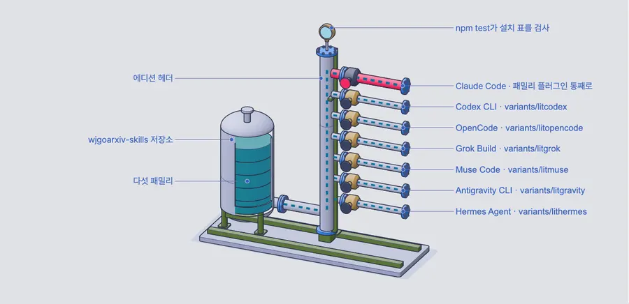
  </picture>
</p>

에디션은 처음에 `variants/<product>/<id>/` 아래로 아무것도 바꾸지 않고 들어왔습니다. 그 제품이 마지막으로 배포한
커밋에서 바이트 단위로 그대로 복사했고, 제품마다 영수증 하나를 `receipts/variants-<product>.sha256`에 남겼습니다.

| 폴더 | 하네스 | 복사한 곳 |
| --- | --- | --- |
| `variants/litcodex/` | Codex CLI | LitCodex `b82ad1c` (1.0.38과 skills lock), `plugins/litcodex/skills/<id>/` |
| `variants/litopencode/` | OpenCode | LitOpenCode `dc56845` (1.0.43과 skills lock), `skills/<id>/` |
| `variants/litgrok/` | Grok Build | LitGrok `8fd2c96` (1.0.34와 skills lock), `.grok/skills/<id>/` |
| `variants/litgravity/` | Antigravity CLI | LitGravity `9f2533c` (0.1.8과 skills lock), `plugin/skills/<id>/` |
| `variants/litmuse/` | Muse Code | LitMuse `e966b07` (0.1.11과 skills lock), `plugin/skills/<id>/` |
| `variants/lithermes/` | Hermes Agent | LitHermes `a2466f2` (1.0.39와 skills lock), `packages/lithermes-installer/assets/lithermes-plugin/skills/<id>/` |

제품 안에 있을 때 각 에디션은 폴더 하나만 설치해서는 따라오지 않는 것들에 기대고 있었습니다. 런타임 명령, 환경 변수,
훅과 완료 관문, doctor 항목, 에이전트 정의, 그리고 이웃 스킬이나 제품 공용 `lib/`, `vendor/` 폴더에 있는 파일들입니다.
그래서 제품마다 커밋을 하나 더 해서 폴더가 혼자 돌아가게 만들었습니다. 읽는 파일은 폴더 안으로 복사하고, 제품 명령은
폴더 안의 스크립트로 바꾸고, 폴더 밖으로 나가는 경로는 모두 없앴습니다. 바뀐 내용과 이유는
`variants/<product>/CHANGES.md`에 하나씩 적혀 있습니다. 절차, 참고 자료, 엔진, QA 게이트는 그대로이고, Codex 에디션만
LitCodex 플러그인 내부를 돌리던 테스트를 뺐습니다.

일부 내부 이름은 일부러 남겼습니다. 측정해 둔 기댓값이나 저장된 파일이 그 이름에 의존하기 때문입니다. `litfamily.*`
같은 스키마 id와 제품 접두사가 붙은 id, 견본 커버 레시피의 브랜드 단어, 그리고 Codex 에디션 스크립트의 `LITCODEX_*`
설정값과 오류 코드가 그렇습니다. frontend-ui-ux의 `references/_canonical-corpus/`처럼 해시로 고정한 외부 자료는 손대지
않았기 때문에, 그 안에 다른 코딩 에이전트 이름이 나올 수 있습니다.

### 스킬 이름에 `lit-`이 남아 있는 이유

`lit-` 접두사는 스킬이 어디서 왔는지를 남겨 둔 표시일 뿐, 이 스킬을 쓰는 데 lit이라는 이름의 무언가가 따로 필요하지는
않습니다. id를 그대로 둔 것은 각 LitFamily 제품의 스텁이 같은 이름을 쓰기 때문입니다. LitFamily 제품이 설치되어 있으면
그 라우팅이 이 이름으로 옮겨 간 스킬을 찾아내고, 없으면 그냥 이름일 뿐입니다. 여기서 이름을 바꾸면 그 연결이 끊기고,
복사본이 원본과 같다는 것을 증명하는 영수증도 더는 맞지 않게 됩니다.

## 구성

```
README.md, README_ko-KR.md          이 페이지의 영어판과 한국어판
docs/assets/                        이 페이지에 쓰인 커버, 다이어그램, 도면, 패밀리별 그림
.claude-plugin/marketplace.json     패밀리 플러그인마다 항목 하나
plugins/<family>/.claude-plugin/plugin.json
plugins/<family>/skills/<id>/       그대로 복사한 스킬 폴더
plugins/<family>/lib/               스킬이 ../../lib로 읽는 공용 런타임 파일, 그대로 복사
plugins/<family>/bin/, vendor/      (figures) 어댑터가 ../../bin, ../../vendor로 읽는 doctor와 원본 소스
plugins/<family>/LICENSE            파일이 원래 따르던 라이선스
receipts/<family>.sha256            복사한 파일마다 sha256, 원본 경로, 대상 경로
variants/<product>/<id>/            다른 제품이 만든 그 스킬의 에디션, 혼자 돌아가도록 손본 것
variants/<product>/CHANGES.md       원본 복사 뒤에 그 에디션에서 바뀐 것과 이유
receipts/variants-<product>.sha256  sha256, 그 제품 커밋에서의 원본 경로, 원본 복사본의 대상 경로
test/                               매니페스트, 영수증, 설치 표를 확인하는 node --test 검사
```

`decks`는 LitClaude 오피스 런타임 파일 16개를 `lib/`에 담고 있습니다. 처음 쓸 때 실행되는 설치 프로그램
(`office-runtime.mjs`와 잠금 파일), Python 부트스트랩, 데이터, 무결성, 렌더, 마크 도우미와 이들이 불러오는 모듈입니다.
`documents`도 lit-docx를 위해 같은 16개 파일을 담고 있습니다. LitClaude는 이제 오피스 런타임을 직접 배포하지 않습니다.
버전이 고정된 런타임은 처음 쓸 때 `${XDG_CACHE_HOME:-~/.cache}/litclaude/office-runtime`에 설치됩니다. 예전 LitClaude
릴리스가 쓰던 캐시와 같은 곳이라, `decks`와 `documents`, 예전 LitClaude가 함께 있는 컴퓨터에서도 한 번만 설치됩니다.
두 사본의 차이는 `office-runtime.mjs` 하나뿐인데, `documents` 쪽은 lit-docx가 쓰는 Python 부분이 설치되면 상태가
`ready`로 표시됩니다.

`figures`는 세 스킬이 자기 폴더 밖에서 읽는 파일을, 바꾸지 않고 같은 상대 위치에 담고 있습니다.
- `lib/`: 마크 도우미와 그것이 불러오는 모듈, 그리고 다이어그램 렌더러용 `npm-invocation.mjs`
- `skills/lit-humanizer/`: 다이어그램 검증기와 doctor가 화면에 보이는 글자를 검사할 때 쓰는 `rules.json`과 스크립트
  네 개만. `SKILL.md`가 없으니 여기서는 스킬이 아니고, lit-humanizer 전체는 LitFamily 제품에 남아 있습니다.
- `vendor/scientific-visualization/`: `lit-scientific-visualization`이 플롯을 그리기 전에 읽는 원본 소스 16개 파일과
  출처, MIT 라이선스
- `bin/litclaude-scientific-visualization-doctor.js`와 `lib/bundled-skills-integrity.mjs`: 읽기만 하는 doctor. 무결성
  검사가 `vendor/handoff/`(파일 4개, 출처와 라이선스 포함)까지 보기 때문에 그 사본도 여기 있지만, 다른 곳에서는 쓰지
  않습니다.

`design`은 frontend-ui-ux와 visual-qa가 자기 폴더 밖에서 읽는 파일을, 바꾸지 않고 같은 상대 위치에 담고 있습니다.
- `lib/`: 프로브, 증거 검사기, 리뷰 규칙이 불러오는 `strict-json.mjs`, `rename-aliases.mjs`, `secret-shapes.mjs`
- `skills/browser-drive/scripts/capability-probe.mjs`: 인터페이스 프로브가 브라우저 드라이버를 찾고 확인할 때 씁니다.
  옆에 `SKILL.md`는 없고, browser-drive 자체는 LitFamily 제품에 남아 있습니다.
- `skills/lit-diagram-drawer/assets/fonts/`와 `skills/lit-typographic-motion/fonts/jetbrains-mono/`: OFL 라이선스가 딸린
  Pretendard와 JetBrains Mono 글꼴. 디자인 키트의 `kit/fonts.json`이 경로로 복사하고 sha256으로 확인합니다. 이 폴더들에도
  `SKILL.md`는 없습니다.

LitClaude는 웹 화면 수정을 이 프로브로 확인하기 때문에, frontend-ui-ux 스텁 안에 인터페이스 프로브 스크립트 사본을
남겨 두었습니다.

`video-covers`는 lit-typographic-motion과 readme-studio가 자기 폴더 밖에서 읽는 파일을, 바꾸지 않고 같은 상대 위치에
담고 있습니다.
- `lib/`: 커버 마크와 엔드 카드를 그리는 마크 도우미(`mark.mjs`, `mark-logo.png`, `output_mark.py`), 그리고
  `project-state-root.mjs`와 그것이 불러오는 `rules/` 모듈 세 개
- `skills/lit-pptx/fonts/pretendard/`: OFL 라이선스가 딸린 Pretendard Regular와 Bold. 영상 엔진의 `fonts/manifest.json`이
  경로로 읽고 sha256으로 확인합니다. 여기에는 `SKILL.md`가 없고, lit-pptx 자체는 `decks`에 있습니다.

옮겨 온 lit-typographic-motion 문서는 LitClaude를 염두에 두고 쓴 것이라, 몇 줄은 이 플러그인에 딸려 오지 않는 LitClaude
부품을 설명합니다.
- `SKILL.md`, `references/look.md`, `references/cover.md`에는 Stop 훅이 완료 목록을 확인하고 턴을 붙잡는다고 적혀
  있습니다. 이건 LitClaude 훅이라 LitClaude 밖에서는 동작하지 않습니다. 스킬 자체의 `motion.mjs gate`와 완료 목록은 그대로
  적용되지만, 턴을 대신 끝내 주는 장치는 없습니다.
- 본문과 BLOCKED 14 메시지에는 `litclaude-ai motion-runtime install`이 나옵니다. LitClaude 밖에서, 그리고 1.0.49 이후
  LitClaude 릴리스에서는 같은 설치 프로그램을 플러그인에서 바로 실행하세요:
  `node <plugin>/skills/lit-typographic-motion/scripts/motion-runtime.mjs install` (또는 `status`). 설치 위치는 LitClaude가
  쓰던 캐시인 `${XDG_CACHE_HOME:-~/.cache}/litclaude/motion-runtime`이라, LitClaude 1.0.49 이하로 미리 받아 둔 컴퓨터라면
  새로 할 일이 없습니다.
- `recipes/painted-light/expected.json`은 LitClaude 저장소의 테스트 픽스처를 가리키는데, 그 픽스처는 가져오지 않았기
  때문에 레시피의 참고 이미지는 설명으로만 남아 있습니다.

lit-schematic은 Pretendard를 먼저 `lit-diagram-drawer/assets/fonts/`에서 찾는데, 이 폴더는 `figures`에 들어 있습니다.
두 번째로 찾는 `lit-pptx/fonts/`는 복사하지 않았습니다.

## 라이선스

저장소 전체에 붙는 라이선스는 따로 없습니다. 패밀리 플러그인마다 원래 파일이 따르던 라이선스를
`plugins/<family>/LICENSE`에 담고, `plugin.json`에 밝혀 두었습니다.

| 플러그인 | 밝힌 라이선스 | 출처 |
| --- | --- | --- |
| `decks` | MIT | LitClaude 자체 파일 |
| `documents` | MIT | LitClaude 자체 파일 |
| `figures` | MIT | LitClaude 자체 파일. `vendor/` 아래 사본은 각자의 출처와 라이선스 파일을 그대로 지닙니다 |
| `design` | MIT AND Apache-2.0 | frontend-ui-ux의 `LICENSE`(MIT)와 `THIRD-PARTY-NOTICE.txt`가 디자인 데이터를, `references/_canonical-corpus/legal/`의 Apache-2.0 라이선스가 참고 코퍼스를 다룹니다 |
| `video-covers` | MIT AND OFL-1.1 | LitClaude 자체 파일과 OFL 라이선스를 따르는 Pretendard 글꼴 |

Pretendard와 JetBrains Mono 글꼴은 수정하지 않은 채 각자의 OFL 라이선스 파일과 함께 들어 있습니다. `variants/`의
에디션은 제품이 스킬 폴더 안에 넣어 배포하던 라이선스와 글꼴 라이선스 파일을 그대로 지니고 있습니다. `docs/assets/`의
그림은 이 페이지를 위해 만든 것이고, 그 안의 글꼴은 렌더링된 픽셀로만 들어 있습니다.

## 이 저장소의 규칙

- 옮겨 오는 스킬은 바이트 단위로 그대로 복사합니다. 영수증과 일치해야 하며, `npm test`가 이를 확인합니다.
- `variants/`의 하네스 에디션은 처음에 그 제품이 마지막으로 배포한 커밋에서 바이트 단위로 그대로 들어오고, 파일마다
  영수증 행을 남겨 영수증과 같은 커밋에 넣습니다. 혼자 돌아가도록 손보는 변경은 그 뒤 별도 커밋으로 하고, 그 제품의
  `CHANGES.md`에 적습니다.
- 제품 스텁의 설치 명령이 바뀌면, 같은 커밋에서 설치 표도 바꿉니다.
- 패밀리는 그 제품의 한 릴리스에서, 제품 스텁과 함께 옮깁니다.
- 패밀리 플러그인은 LitFamily 제품이 하나도 없어도 동작해야 합니다.

## 확인

```bash
npm test
claude plugin validate .
claude plugin validate plugins/decks
claude plugin validate plugins/documents
claude plugin validate plugins/figures
claude plugin validate plugins/design
claude plugin validate plugins/video-covers
```
